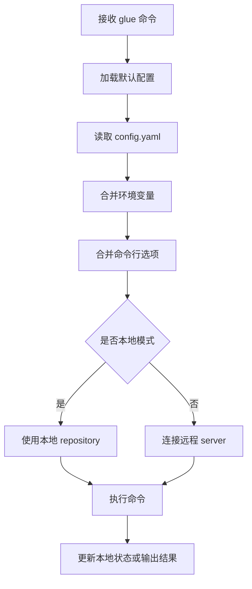

# 命令行工具设计

## 概述

`glue` 是 prompts-glue 的命令行客户端，用于在终端中完成提示词包的创建、安装、移除、升级、缓存管理、信息查看、配置管理、版本查看、发布、登录和模板渲染操作。

命令行工具既支持连接远程 server 进行搜索、发布、下载和账号相关操作，也支持本地模式在不连接远程 server 的情况下管理本地提示词仓库。

## 设计目标

- 为开发者提供统一的提示词包生命周期管理入口。
- 支持本地仓库和远程 server 两种工作模式。
- 支持通过配置文件、环境变量和命令行选项统一配置行为。
- 支持 LLM 模型配置，满足提示词制作、复合提示词计算和实时生成场景。
- 支持跨平台使用，命令语义保持稳定。

## 命令格式

命令行工具名称为 `glue`。

| 格式　　　　　　　　 | 说明　 |         |        |       |      |        |         |         |                     |          | 　　　　　　　　 |
| ----------------------| --------| ---------| --------| -------| ------| --------| ---------| ---------| ---------------------| --------| ------------------|
| `glue [options] <add | remove | upgrade | create | template | cache | info | config | version | publish | login>` | 执行指定命令　　 |
| `glue [options] <add | remove | upgrade | create | template | cache | info | config | version | publish | login> [arguments]` | 执行带参数的命令 |

支持的命令取值见 [dicts.md](dicts.md) 中的“CLI 命令”定义。

## 全局选项

全局选项可作用于所有命令。命令行选项优先级高于环境变量和配置文件。

| 选项　　　　　　| 类型　 | 说明　　　　　　　　　　　　　　　　　　　　　　　　　　　　　　　　 |
| -----------------| --------| ----------------------------------------------------------------------|
| `--local`　　　 | 布尔值 | 本地操作模式，不连接远程 server；`create` 命令直接在本地创建提示词包 |
| `--llm-model`　 | 字符串 | 指定提示词制作和计算使用的语言模型（仅本地模式需要）　　　　　　　　 |
| `--llm-api-base` | 字符串 | 指定语言模型服务的访问入口（仅本地模式需要）　　　　　　　　　　　 |
| `--llm-api-key`  | 字符串 | 指定语言模型服务的 API Key（仅本地模式需要）　　　　　　　　　　　　|
| `--llm-proxy`　  | 字符串 | 指定访问语言模型服务时使用的代理（仅本地模式需要）　　　　　　　　　|

全局选项只描述本次命令执行行为，不应直接改写配置文件。需要持久化配置时应使用 `config` 命令。

## 远程模式

未启用 `--local` 时为远程模式，CLI 连接远程 server 完成操作，远程模式下不需要本地 LLM 配置：模板/表达式求值由 server 端 `/api/registry/generate` 执行，依赖与指令计算在 server 侧完成。

| 命令 | 远程模式行为 |
|---|---|
| login | 以用户名密码登录 web 域，获取访问令牌（不过期）并写入 `server.token`（config.yaml，0600）；可用 `--username`/`--password` 或 `GLUE_USERNAME`/`GLUE_PASSWORD` 提供凭据，缺则交互输入 |
| template | 逐 `{{...}}` 占位符调用 server `generate` 求值并组装，无需本地 LLM 与本地 repository |
| content | 从 server 拉取指定版本正文输出 |
| info | 从 server 查询包/版本信息，`--deps` 展示依赖 |
| add | 从 server 拉取包与依赖写入本地 repository，递归带 visited 去重与深度上限防环 |
| upgrade | 比对 server 最新版本，拉取新版本到本地 repository |
| publish | 读取本地包并 POST 到 server 发布，`--dry-run` 仅校验 |

远程模式需先 `glue login` 或在 `server.token` 配置个人访问令牌（可在 web 个人中心创建）。令牌缺失或失效时命令提示 `run glue login`。token 消耗记在登录用户下。

## 命令设计

### add

安装或添加提示词包到本地 repository 或目标项目。

| 能力 | 说明 |
|---|---|
| 添加远程包 | 从远程 server 获取提示词包及其依赖，并写入本地 repository |
| 添加本地包 | 在本地模式下从本地路径或本地 repository 添加提示词包 |
| 版本选择 | 支持按版本选择规则安装指定版本 |
| 依赖处理 | 自动解析并安装必要依赖 |

### remove

从本地 repository 或目标项目移除提示词包。

| 能力 | 说明 |
|---|---|
| 移除包 | 删除本地已安装提示词包记录和文件 |
| 依赖检查 | 如果其他包仍依赖该包，应提示影响范围 |
| 本地模式 | 仅修改本地 repository，不访问远程 server |

### upgrade

升级本地已安装的提示词包。

| 能力 | 说明 |
|---|---|
| 单包升级 | 升级指定提示词包到满足版本规则的最新版本 |
| 批量升级 | 检查并升级多个已安装包 |
| 依赖升级 | 根据依赖规则同步升级依赖包 |
| 变更预览 | 展示版本变化、依赖变化和可能影响 |

### create

创建提示词包。

| 能力 | 说明 |
|---|---|
| 创建普通提示词 | 创建 `type` 为 plain 的提示词包草稿 |
| 创建复合提示词 | 根据 expression 创建 `type` 为 composite 的提示词包草稿 |
| 本地创建 | 使用 `--local` 时直接在本地 repository 创建，不连接远程 server |
| LLM 生成 | 需要制作指令计算时，根据 LLM 配置调用模型并记录 token 消耗 |

### cache

管理提示词计算缓存。

| 能力 | 说明 |
|---|---|
| 查看缓存 | 查看本地缓存统计、缓存对象和最近更新时间 |
| 清理缓存 | 按提示词包、表达式、过期时间或全部范围清理缓存 |
| 验证缓存 | 检查缓存依赖版本是否仍然有效 |
| 本地模式 | 仅管理本地缓存，不访问远程 server |

### info

查看提示词包、配置、依赖或本地 repository 信息。

| 能力 | 说明 |
|---|---|
| 包信息 | 展示包名、版本、状态、分类、标签、作者和依赖 |
| 依赖信息 | 展示直接依赖和解析后的依赖版本 |
| 本地信息 | 展示本地 repository 路径、缓存状态和配置来源 |
| 远程信息 | 非本地模式下可查询远程 server 上的包信息 |

### config

查看和修改配置。

| 能力 | 说明 |
|---|---|
| 查看配置 | 展示合并后的有效配置和配置来源 |
| 设置配置 | 写入 `config.yaml` 中的指定配置项 |
| 删除配置 | 从 `config.yaml` 移除指定配置项 |
| 校验配置 | 检查配置格式、路径和 LLM 选项是否可用 |

### version

查看 CLI 版本和运行环境信息。

| 能力 | 说明 |
|---|---|
| CLI 版本 | 展示 glue 当前版本 |
| 协议版本 | 展示与远程 server 交互使用的协议版本 |
| 构建信息 | 展示构建时间、目标平台和提交标识 |

### publish

发布提示词包到远程 server。

| 能力 | 说明 |
|---|---|
| 发布包 | 上传提示词包元数据、内容、表达式和依赖信息 |
| 发布校验 | 校验 package 属性、版本、状态、分类、表达式和依赖 |
| token 记录 | 对发布前需要重新计算的复合提示词记录 token 消耗 |
| 本地限制 | 本地模式下不连接远程 server，不执行远程发布 |

### login

登录远程 server，建立发布和私有包访问所需的认证状态。

| 能力　　 | 说明　　　　　　　　　　　　　　　　　　　|
| ----------| -------------------------------------------|
| 用户登录 | 获取或保存访问远程 server 所需的认证信息　|
| 状态查看 | 展示当前登录状态、server 和用户标识　　　 |
| 本地限制 | 本地模式下不需要登录，也不访问远程 server |

### template

渲染模板文件，把其中的 `{{...}}` 占位符替换为对应提示词内容或 glue 表达式求值结果后输出。

| 能力 | 说明 |
|---|---|
| 模板输入 | 通过 `--content-file`、`--content` 或 stdin 提供模板内容，优先级 `--content-file` > `--content` > stdin |
| 占位符求值 | 占位符 `{{ glue 表达式 }}` 内部按 glue 表达式求值；提示词 id 是最简表达式，等价于引用其内容 |
| 变量上下文 | 通过 `--var key=value` 提供表达式中的 `$变量`，可重复 |
| 指令求值 | 含制作指令或组合运算符的占位符复用 LLM 配置，未配置时命中即报错 |
| 严格失败 | 任一占位符解析或求值失败即终止，不输出部分结果 |
| 本地模式 | 仅从本地 repository 加载提示词引用，不连接远程 server |

占位符语法：

- 占位符以 `{{` 开始、`}}` 结束，内部为 glue 表达式，首尾空白会被忽略。
- 占位符内的字符串字面量与制作指令 option 的花括号会被正确识别，不会误触发占位符闭合。
- 示例：`{{ base-rules }}`、`{{ "片段" }}`、`{{ summary($text){...} }}`、`{{ a | b }}`。
- 当前版本不支持在模板中转义输出字面 `{{`。

## 本地模式

`--local` 表示本地操作模式。启用后，CLI 不连接远程 server，只使用本地配置目录和本地 repository。

| 命令 | 本地模式行为 |
|---|---|
| add | 从本地路径或本地 repository 添加提示词包 |
| remove | 从本地 repository 移除提示词包 |
| upgrade | 仅基于本地 repository 中已有版本进行升级判断 |
| create | 直接在本地 repository 创建提示词包 |
| cache | 管理本地缓存 |
| info | 查看本地包、配置和 repository 信息 |
| config | 修改本地配置文件 |
| version | 展示本地 CLI 版本信息 |
| publish | 不执行远程发布，应提示需要关闭本地模式 |
| template | 仅从本地 repository 加载提示词引用，不连接远程 server |
| login | 不执行远程登录，应提示本地模式无需登录 |

本地模式适用于离线制作、私有项目内使用、测试表达式、渲染模板和调试缓存。

## 配置设计

### 配置目录

默认配置目录为 `~/.glue`。

| 路径 | 说明 |
|---|---|
| `~/.glue/config.yaml` | 用户级配置文件 |
| `~/.glue/repository` | 本地提示词包仓库 |

可通过 `GLUE_HOME` 调整配置目录。调整后，`config.yaml` 和 `repository` 都应位于新的配置目录下。

### 配置来源

配置可来自以下来源：

| 来源 | 说明 |
|---|---|
| 默认值 | CLI 内置的默认配置 |
| 配置文件 | 配置目录下的 `config.yaml`，可设置所有 glue 选项 |
| 环境变量 | 以 `GLUE_` 开头的环境变量，可覆盖所有配置文件配置项 |
| 命令行选项 | 当前命令显式传入的选项，可设置所有 glue 选项 |

配置优先级从高到低为：命令行选项 > 环境变量 > config.yaml。未配置的项目使用 CLI 默认值。

### 环境变量映射

环境变量统一使用 `GLUE_` 前缀。`config.yaml` 中的所有配置项都可以通过环境变量配置，变量名中的双下划线表示配置路径中的点号；数组类型配置使用 `__数组元素位置__` 表示元素位置。

| 规则 | 说明 |
|---|---|
| 前缀 | 所有环境变量使用 `GLUE_` 开头 |
| 层级 | 配置路径中的点号使用双下划线表示 |
| 数组 | 数组元素位置使用 `__数组元素位置__` 表示，位置从 0 开始 |
| 名称 | 配置项名称转换为大写 |
| 覆盖 | 环境变量覆盖配置文件中的同名配置项 |

| 环境变量 | 配置项 | 说明 |
|---|---|---|
| `GLUE_HOME` | home | 配置目录 |
| `GLUE_REPOSITORY__PATH` | repository.path | 本地提示词包仓库路径 |
| `GLUE_SERVER__BASE` | server.base | 远程 server 访问入口 |
| `GLUE_SERVER__TOKEN` | server.token | 访问令牌 |
| `GLUE_USERNAME` | — | `glue login` 默认用户名 |
| `GLUE_PASSWORD` | — | `glue login` 默认密码 |
| `GLUE_LOCAL` | local | 是否默认启用本地模式 |
| `GLUE_LLM__MODEL` | llm.model | 语言模型名称 |
| `GLUE_LLM__API_BASE` | llm.api_base | OpenAI 兼容接口的 ApiBase |
| `GLUE_LLM__API_KEY` | llm.api_key | 语言模型服务 API Key |
| `GLUE_LLM__PROXY` | llm.proxy | 语言模型代理 |
| `GLUE_CACHE__ENABLED` | cache.enabled | 是否启用本地计算缓存 |
| `GLUE_CACHE__STRATEGY` | cache.strategy | 默认缓存策略 |
| `GLUE_REPOSITORIES__0__NAME` | repositories.0.name | 数组配置中第 0 个元素的名称 |

示例：`GLUE_LLM__MODEL="deepseek-v4-flash"` 表示设置 `llm.model`；`GLUE_REPOSITORIES__0__NAME="default"` 表示设置 `repositories` 数组中第 0 个元素的 `name`。新增配置项应自动遵循同一映射规则，不需要额外设计专用环境变量。

### 配置项

| 配置项 | 类型 | 说明 |
|---|---|---|
| home | 字符串 | 配置目录，由 `GLUE_HOME` 控制 |
| repository.path | 字符串 | 本地提示词包仓库路径 |
| server.base | 字符串 | 远程 server 访问入口 |
| server.token | 字符串 | 访问令牌（`glue login` 自动写入或粘贴个人访问令牌），展示时掩码 |
| local | 布尔值 | 是否默认启用本地模式 |
| llm.model | 字符串 | 默认语言模型 |
| llm.api_base | 字符串 | OpenAI 兼容接口的 ApiBase，实际聊天补全接口固定为 `${ApiBase}/chat/completions` |
| llm.api_key | 字符串 | 语言模型服务 API Key |
| llm.proxy | 字符串 | 默认语言模型代理 |
| cache.enabled | 布尔值 | 是否启用本地计算缓存 |
| cache.strategy | 提示词缓存策略 | 默认缓存策略，取值见 dicts.md |

所有 glue 选项都应能映射到配置项，并可通过 `config.yaml` 设置；所有配置文件配置项都应能通过环境变量覆盖；所有配置项也应能通过命令行选项参数在单次执行中覆盖。配置文件不应保存短期命令状态。

## Repository 设计

本地 repository 用于保存已安装、已创建和已缓存的提示词包。

| 内容 | 说明 |
|---|---|
| package 文件 | 保存提示词包的 Markdown 文件和 package 属性 |
| 版本索引 | 记录本地已知包版本和状态 |
| 依赖索引 | 记录本地包之间的依赖关系 |
| 缓存索引 | 记录计算缓存键、依赖解析版本和生成时间 |

repository 应能支持离线查询、离线创建和本地依赖解析。远程同步不应破坏本地未发布草稿。

## LLM 配置与 token 记录

提示词制作指令都通过 SDK 内置的 LLM 执行器调用模型完成，CLI 读取 LLM 配置并传给 SDK，用于 `create`（复合提示词计算）等场景；未配置 LLM 时命中指令即报错，本地模式复合提示词同样需配置 LLM。LLM API 仅支持 OpenAI 兼容的聊天补全格式，实际请求地址固定为 `${ApiBase}/chat/completions`，其中 `ApiBase` 来自 `llm.api_base`。

| 配置项 | 来源 | 说明 |
|---|---|---|
| llm.model | `--llm-model`、`GLUE_LLM__MODEL`、config.yaml | 使用的模型名称 |
| llm.api_base | `--llm-api-base`、`GLUE_LLM__API_BASE`、config.yaml | OpenAI 兼容接口的 ApiBase，CLI 仅支持请求 `${ApiBase}/chat/completions` |
| llm.api_key | `--llm-api-key`、`GLUE_LLM__API_KEY`、config.yaml | 模型服务 API Key |
| llm.proxy | `--llm-proxy`、`GLUE_LLM__PROXY`、config.yaml | 模型服务代理 |

执行 LLM 指令前应估算 token 消耗；执行后应记录输入 token、输出 token、总 token、模型名称和计算时间。缓存命中时不应重复消耗 token，但应记录本次结果来自缓存。

## 交互流程

## 错误处理

| 场景 | 处理要求 |
|---|---|
| 配置文件不存在 | 使用默认配置，并在需要写入时创建配置文件 |
| 配置格式错误 | 终止命令并提示错误位置 |
| repository 不存在 | 在需要写入时创建，在只读命令中提示未初始化 |
| 本地模式执行远程命令 | 不连接远程 server，提示当前命令需要远程模式 |
| LLM 配置缺失 | 对需要模型生成的命令终止并提示补充配置 |
| 远程 server 不可用 | 保留本地状态，不应破坏已有 repository |
| 依赖解析失败 | 输出失败依赖、版本规则和建议操作 |

## 安全要求

- 登录凭据不得写入提示词包文件或缓存内容。
- 配置展示时应隐藏密钥、令牌等敏感字段。
- 发布前应展示包名、版本、依赖和目标 server。
- 本地 repository 中的草稿和未发布内容不应被自动上传。
- LLM 请求不得自动携带与当前提示词无关的本地文件内容。
- 缓存内容应遵守提示词缓存策略，包含敏感输入的实时生成结果不应写入共享缓存。
