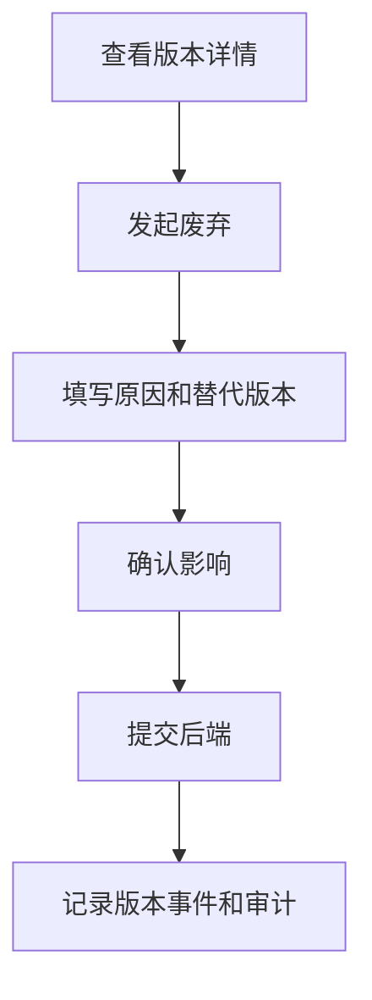
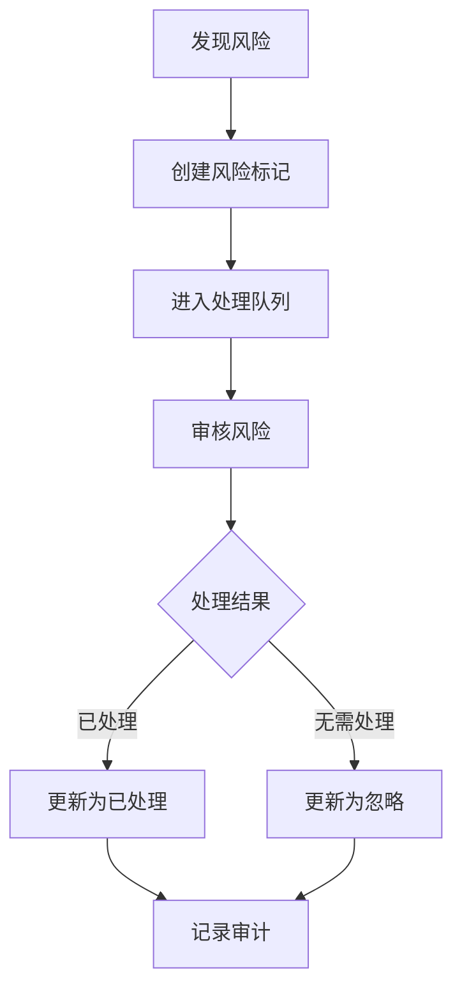
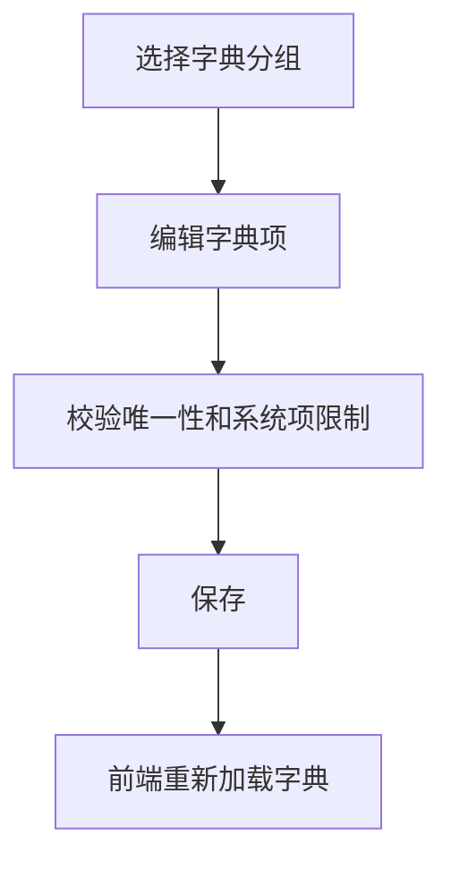

# 管理界面设计

## 概述

管理界面是 prompts-glue 面向管理员和运营人员的 Web 应用，用于管理提示词包、版本、用户、命名空间、字典、服务配置、风险标记、缓存和审计数据。管理界面通过后端管理 API 工作，不直接访问数据库。

## 设计目标

- 提供系统运营、治理和审计入口。
- 支持提示词包和版本的搜索、查看、废弃和风险处理。
- 支持用户、命名空间、成员和角色管理。
- 支持数据字典和服务配置的动态维护。
- 支持生成记录、缓存命中、下载记录和审计日志查询。
- 通过后端字典 API 加载所有业务编码，避免前端硬编码。
- 保证高影响操作有明确确认、审计和反馈。

## 非目标

| 非目标 | 说明 |
|---|---|
| 普通用户提示词制作 | 由用户端门户负责 |
| CLI 本地仓库管理 | 由命令行客户端负责 |
| 后端业务规则替代 | 管理端只调用 API，不复制权限和发布规则 |
| 数据库直连 | 所有数据访问通过后端 API 完成 |

## 管理范围

| 范围 | 能力 |
|---|---|
| 仪表盘 | 展示包、版本、用户、生成、缓存、风险概览 |
| 包管理 | 搜索包、查看版本、查看依赖、废弃版本、标记风险 |
| 用户管理 | 管理端用户与 web 用户的增删改查、启停、重置密码、令牌管理（查看/吊销）；触发 LDAP 同步 |
| 角色与权限 | 角色、权限、成员的维护（基于 RBAC） |
| 命名空间管理 | 查看命名空间、成员和角色 |
| 字典管理 | 维护字典分组、字典项、排序、启用状态 |
| 服务配置 | 维护缓存、生成限制、审核策略等服务配置 |
| 风险处理 | 创建、查看、流转和关闭风险标记 |
| 审计日志 | 查询登录、发布、废弃、配置、成员和风险操作 |
| 生成记录 | 查询实时生成和复合提示词计算记录 |
| 缓存管理 | 查看缓存统计和清理缓存项 |

## 页面结构

| 页面 | 说明 |
|---|---|
| 登录页 | 管理端用户登录（`/api/admin/auth/login`） |
| 仪表盘 | 系统运营指标、趋势和风险提示 |
| 包列表 | 搜索、筛选、排序提示词包 |
| 包详情 | 查看包概要、版本、标签、下载记录和风险标记 |
| 版本详情 | 查看元数据、内容摘要、依赖、生成记录和事件 |
| 用户管理（主导航 Web 用户） | Web 用户的增删改查、启停、重置密码、令牌管理，支持用户名/姓名/邮箱与状态筛选 |
| 命名空间 | 管理命名空间基本信息和成员角色 |
| 角色管理（系统管理下，角色前） | 左侧角色列表增删改；右侧 成员/权限 tab：成员增删、权限按 code 前缀分组勾选保存 |
| 字典管理 | 管理字典分组和字典项 |
| 配置管理 | 查看和维护服务级配置 |
| 风险列表 | 处理风险标记和状态流转 |
| 审计日志 | 按用户、资源、动作、时间查询审计记录 |
| 缓存管理 | 查看缓存项、命中次数、过期时间并清理 |

## 权限与访问

管理界面只允许具备管理权限的用户访问。前端可根据当前身份隐藏不可用入口，但最终权限由后端服务判定。

| 操作 | 权限要求 |
|---|---|
| 查看仪表盘 | 管理员或运营角色 |
| 查看包和版本 | 管理员或运营角色 |
| 废弃版本 | 管理员或包维护者 |
| 管理用户 | 管理员 |
| 管理命名空间成员 | 管理员或命名空间所有者 |
| 管理字典 | 管理员 |
| 修改服务配置 | 管理员 |
| 处理风险 | 管理员或运营角色 |
| 查看审计日志 | 管理员 |
| 清理缓存 | 管理员或包维护者 |

## 数据字典使用

| 字典分组 | 使用场景 |
|---|---|
| 提示词类型 | 包和版本筛选、详情展示 |
| 提示词分类 | 包筛选和字典维护 |
| 版本状态 | 版本筛选、状态标签、废弃流程 |
| 账号状态 | 用户列表和用户详情 |
| 管理角色 | 管理端用户列表和创建表单 |
| 账号来源 | web 用户列表展示来源标签 |
| 资源可见性 | 包、命名空间和筛选条件 |
| 命名空间角色 | 成员管理 |
| 风险类型 | 风险创建和筛选 |
| 风险等级 | 风险优先级和统计 |
| 风险处理状态 | 风险流程和筛选 |
| 审计操作类型 | 审计查询 |
| 操作结果 | 审计结果展示 |
| 缓存策略 | 配置管理和缓存筛选 |

字典项的展示名称、排序和启用状态以后端返回为准。

## 管理流程

### 版本废弃

### 风险处理

### 字典维护

## API 交互

| 功能 | API |
|---|---|
| 登录和身份 | 管理端认证 API（`/api/admin/auth/login`、`/api/admin/auth/me`） |
| 字典读取 | 字典 API |
| 字典维护 | 管理字典 API |
| 用户管理 | 管理端用户 CRUD API（`/api/admin/manager-users`）与 web 用户 CRUD API（`/api/admin/users`） |
| 用户令牌管理 | `GET /api/admin/{users|manager-users}/{id}/tokens`、`DELETE .../{id}/tokens/{tid}` |
| 角色与权限 | `/api/admin/roles`（列表/新建/`{id}` 详情/更新/删除）、`PUT /roles/{id}/permissions`、`GET/PUT /roles/{id}/members`、`GET /api/admin/permissions` |
| LDAP 同步 | `/api/admin/ldap/sync` 触发用户同步 |
| 命名空间管理 | 管理命名空间 API |
| 包和版本管理 | Registry API 与管理包 API |
| 服务配置 | 管理配置 API |
| 风险处理 | 管理风险 API |
| 审计查询 | 管理审计 API |
| 缓存管理 | Registry 缓存 API 与管理缓存 API |

## 组件要求

| 组件 | 说明 |
|---|---|
| 管理布局 | 顶部用户信息、侧边导航、内容区 |
| 数据表格 | 分页、筛选、排序、加载和空状态 |
| 字典标签 | 根据字典项展示标签、颜色和说明 |
| 确认对话框 | 用于废弃、禁用、清理等高影响操作 |
| 表单抽屉 | 用于编辑字典、配置、风险和成员 |
| 统计卡片 | 展示指标和趋势 |
| 审计详情 | 展示资源、动作、结果、request_id 和时间 |
| API Client | 统一认证、错误处理和响应解析 |

禁止使用浏览器原生 `alert`、`confirm`、`prompt`。

## 安全要求

- 管理端不得回显密钥、令牌、密码和加密配置明文。
- 不将访问令牌放入 URL 或日志。
- 高影响操作必须明确展示影响范围和确认步骤。
- 管理端的隐藏按钮不能替代后端权限校验。
- 审计日志和错误详情不得展示敏感输入或内部调用栈。
- Markdown 或用户内容预览必须安全渲染。

## 可观测性

- 所有失败请求展示 request_id，便于管理员定位日志。
- 配置变更、字典变更、用户状态变更、风险处理、版本废弃应写入审计。
- 仪表盘指标来自后端聚合接口，不由前端自行推断权威统计。

## 验证要求

| 验证 | 内容 |
|---|---|
| 类型检查 | API 类型和组件属性一致 |
| 构建验证 | 生产构建成功 |
| 权限验证 | 未登录、普通用户、管理员访问差异 |
| 字典验证 | 业务编码全部来自字典 API |
| 操作验证 | 废弃版本、字典维护、风险处理、缓存清理 |
| 安全验证 | 不使用原生对话框，不回显敏感配置 |
