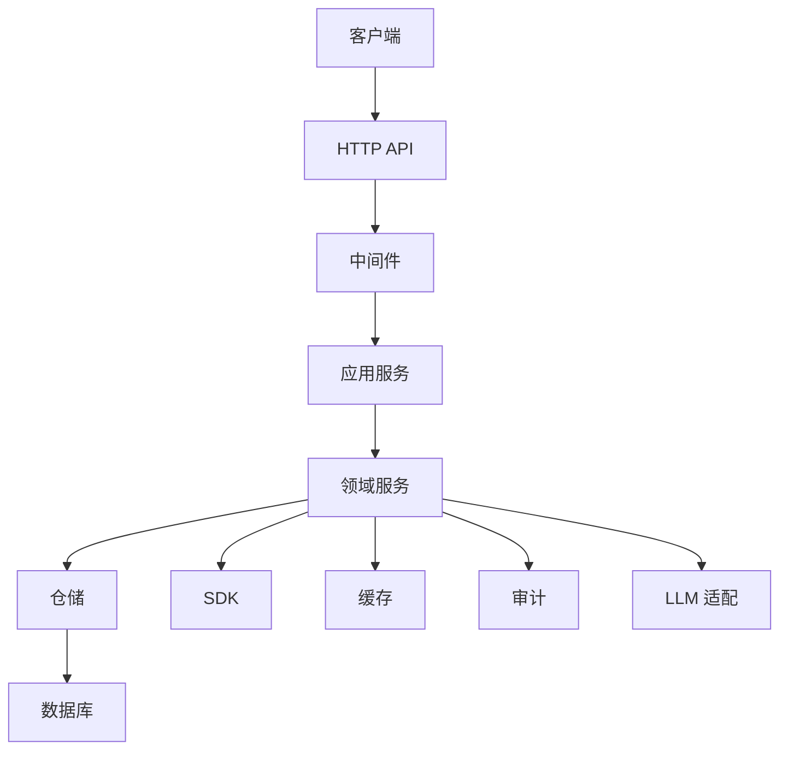

# 后端服务设计

## 概述

后端服务是 prompts-glue 的中心服务，负责提示词包注册、搜索、发布、下载、实时生成、依赖解析、账号权限、数据字典、缓存治理、审计和运营管理能力。CLI、用户端门户和管理界面均通过后端服务访问远程能力。

后端服务对外提供稳定 API，对内复用 SDK 的表达式解析、校验、依赖抽取和运行能力。SDK 不直接访问数据库、网络或文件系统，后端服务负责提供内容加载、缓存、权限和审计上下文。

## 设计目标

- 为 CLI、Web、Manager 提供统一远程服务入口。
- 维护提示词包、版本、内容、依赖、生成记录和审计数据的权威状态。
- 支持公开访问、私有资源、命名空间和维护权限控制。
- 支持复合提示词发布前校验、实时生成、缓存命中和 token 用量记录。
- 支持管理端进行用户、包、字典、配置、风险和审计运营。
- 支持 SQLite、MySQL、PostgreSQL 多数据库部署。
- 保证响应结构、错误码、请求追踪和日志输出一致。

## 模块边界

| 模块 | 后端服务职责 | 非后端服务职责 |
|---|---|---|
| CLI | 提供远程包、发布、登录、缓存 API | 本地文件安装、终端交互、配置合并 |
| Web | 提供搜索、详情、发布、生成 API | 页面渲染、交互状态、用户体验 |
| Manager | 提供管理和运营 API | 管理端页面流程和可视化 |
| SDK | 调用 SDK 解析和运行表达式 | 在 SDK 内实现权限、存储、网络访问 |
| 数据库 | 保存服务端权威数据 | 替代 CLI 本地 repository |

## 服务分层

| 层级 | 职责 |
|---|---|
| HTTP API | 路由、请求解析、响应封装和状态码映射 |
| 中间件 | 请求追踪、日志、认证、权限、请求大小限制和错误恢复 |
| 应用服务 | 编排业务用例，处理事务边界和跨领域流程 |
| 领域服务 | 包、版本、依赖、生成、缓存、字典等核心规则 |
| 仓储 | 统一数据库访问、分页、查询条件和事务接口 |
| 外部适配 | LLM 调用、静态文件托管、配置加载和健康检查 |

## 核心能力

| 能力 | 说明 |
|---|---|
| 认证登录 | 支持用户名密码登录和令牌访问；访问令牌只保存摘要 |
| 包搜索 | 按关键词、分类、标签、作者、状态、类型分页搜索 |
| 包详情 | 查看包概要、版本列表、版本元数据、依赖和内容摘要 |
| 包发布 | 校验 package 属性、内容、表达式和权限，发布不可覆盖版本 |
| 版本废弃 | 标记版本废弃并记录原因，不删除历史内容 |
| 版本解析 | 根据版本规则解析实际可用版本 |
| 依赖解析 | 从 expression 提取依赖，解析版本并检测循环依赖 |
| 实时生成 | 根据 expression、输入和缓存策略生成提示词内容 |
| 缓存治理 | 查看缓存项、命中统计、清理过期或指定表达式缓存 |
| 字典管理 | 为前端和管理端提供统一字典值，支持动态启停和排序 |
| 运营管理 | 管理用户、命名空间、服务配置、风险标记、审计记录 |
| 健康检查 | 暴露服务状态、版本、数据库连接和时间信息 |

## 权限模型

权限以用户、访问令牌、命名空间成员和资源可见性共同决定。

| 场景 | 访问要求 |
|---|---|
| 查看公开包 | 匿名可访问 |
| 查看私有或内部包 | 已认证且具备资源访问权限 |
| 发布新包或新版本 | 已认证且具备目标命名空间维护权限 |
| 废弃版本 | 维护者、所有者或管理员 |
| 字典读取 | 匿名可读取启用字典 |
| 字典维护 | 管理员 |
| 服务配置维护 | 管理员 |
| 缓存查看和清理 | 管理员或包维护者 |
| 审计日志查看 | 管理员 |
| 风险标记处理 | 管理员或运营角色 |

权限不足时应返回统一错误，不暴露私有资源是否存在的敏感细节。

## 数据一致性

- 发布版本不可覆盖，相同包名和版本只能存在一条有效记录。
- 包的最新版本只指向可用发布版本。
- 复合提示词必须保存 expression，并由服务端重新解析 dependencies。
- 包内容、依赖、计算记录和版本事件应在同一发布事务中保持一致。
- 废弃版本不删除内容，不破坏精确版本依赖的可复现性。
- 删除用户、命名空间、包、版本等重要资源应优先软删除。
- 审计日志记录重要写操作、认证事件、风险处理和配置变更。

## 配置项

| 配置 | 说明 |
|---|---|
| server.address | 服务监听地址 |
| server.public_base_url | 对外访问基准地址 |
| database.driver | 数据库驱动类型 |
| database.dsn | 数据库连接字符串 |
| auth.token_ttl | 访问令牌有效期 |
| auth.admin_username | 初始化管理员用户名 |
| auth.admin_password | 初始化管理员密码 |
| llm.model | 默认模型名称 |
| llm.api_base | 模型服务访问入口 |
| llm.api_key | 模型服务密钥 |
| llm.proxy | 模型服务代理 |
| cache.default_strategy | 默认缓存策略 |
| cache.ttl | 缓存默认有效期 |
| limits.request_body_bytes | 请求体大小上限 |
| limits.page_size_max | 分页大小上限 |
| limits.expression_length | 表达式长度上限 |
| logging.level | 日志级别 |

敏感配置不得写入日志、错误详情和前端响应。

## 部署形态

| 形态 | 说明 |
|---|---|
| 本地开发 | 后端服务连接 SQLite，Web 和 Manager 独立开发服务代理 API |
| 单容器 | 后端服务托管静态前端产物，连接外部数据库 |
| 多容器 | 后端、Web、Manager、数据库分开部署 |
| 生产环境 | 使用 MySQL 或 PostgreSQL，开启审计、限流、备份和健康检查 |

## 可观测性

- 每个请求生成 `request_id` 并写入响应和日志。
- debug 日志应覆盖配置加载、数据库迁移、路由注册、表达式解析、依赖解析和缓存命中。
- 错误日志不得包含令牌、密钥、密码、完整敏感输入或内部调用栈。
- 生成记录保存 token 用量、耗时、缓存命中和错误码，便于成本分析。

## 安全要求

- 认证凭据不得出现在 URL、日志、缓存内容、package 内容或错误详情中。
- 密码和访问令牌只保存安全摘要。
- 写操作必须校验身份、权限和资源归属。
- 列表分页、请求体大小、表达式长度、依赖深度和生成预算必须有上限。
- LLM 调用输入和缓存内容应避免保存用户标记为敏感的内容。
- 管理端敏感配置不回显明文。

## 验证要求

| 验证 | 内容 |
|---|---|
| 单元测试 | 校验、权限、响应封装、版本解析、依赖解析、缓存键、字典加载 |
| 集成测试 | 登录、发布、搜索、下载、生成、废弃、管理查询 |
| 数据库测试 | SQLite 必测，MySQL 和 PostgreSQL 通过配置验证迁移兼容性 |
| 安全测试 | 令牌脱敏、权限拒绝、私有资源访问、请求大小限制 |
| 联调测试 | CLI、Web、Manager 与后端服务的核心流程 |
