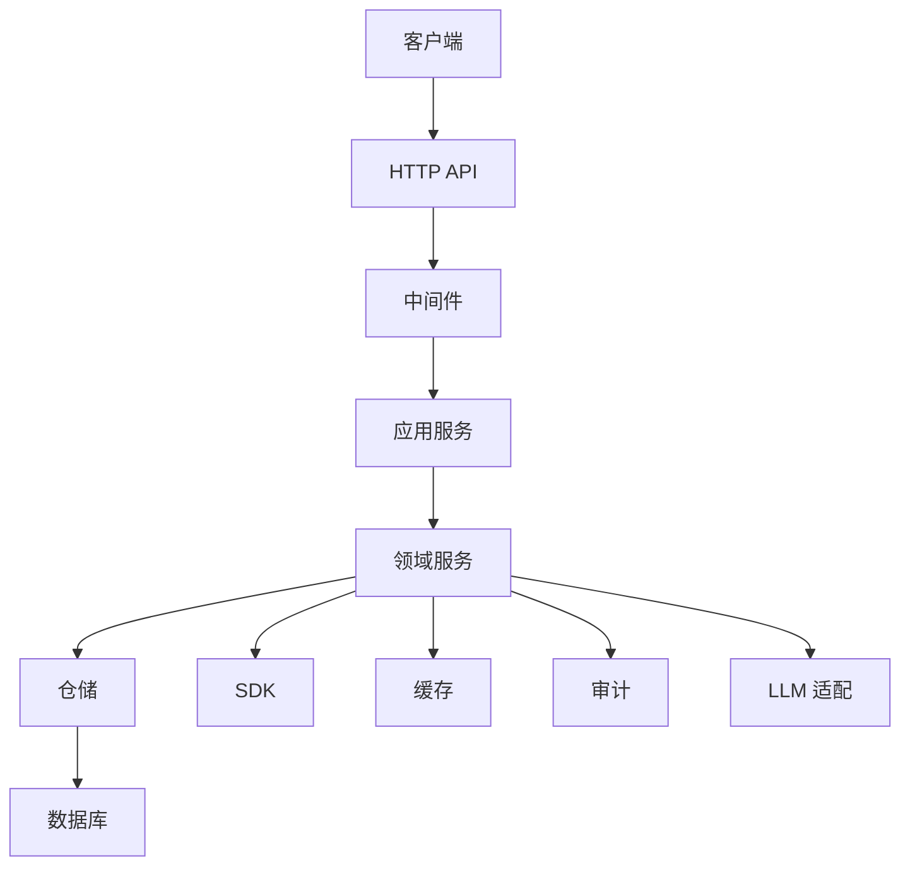

# 后端服务设计

## 概述

后端服务是 prompts-glue 的中心服务，负责提示词包注册、搜索、发布、下载、实时生成、依赖解析、账号权限、数据字典、缓存治理、审计和运营管理能力。CLI、用户端门户和管理界面均通过后端服务访问远程能力。

后端服务对外提供稳定 API，对内复用 SDK 的表达式解析、校验、依赖抽取和运行能力。SDK 不直接访问数据库、网络或文件系统，后端服务负责提供内容加载、缓存、权限和审计上下文。

## 设计目标

- 为 CLI、Web、Manager 提供统一远程服务入口。
- 维护提示词包、版本、内容、依赖、生成记录和审计数据的权威状态。
- 支持公开访问、私有资源、命名空间和维护权限控制。
- 支持复合提示词发布前校验、实时生成、缓存命中和 token 用量记录。
- 支持管理端进行用户、包、字典、配置、风险和审计运营。
- 支持 SQLite、MySQL、PostgreSQL 多数据库部署。
- 保证响应结构、错误码、请求追踪和日志输出一致。

## 模块边界

| 模块 | 后端服务职责 | 非后端服务职责 |
|---|---|---|
| CLI | 提供远程包、发布、登录、缓存 API | 本地文件安装、终端交互、配置合并 |
| Web | 提供搜索、详情、发布、生成 API | 页面渲染、交互状态、用户体验 |
| Manager | 提供管理和运营 API | 管理端页面流程和可视化 |
| SDK | 调用 SDK 解析和运行表达式 | 在 SDK 内实现权限、存储、网络访问 |
| 数据库 | 保存服务端权威数据 | 替代 CLI 本地 repository |

## 服务分层

| 层级 | 职责 |
|---|---|
| HTTP API | 路由、请求解析、响应封装和状态码映射 |
| 中间件 | 请求追踪、日志、认证、权限、请求大小限制和错误恢复 |
| 应用服务 | 编排业务用例，处理事务边界和跨领域流程 |
| 领域服务 | 包、版本、依赖、生成、缓存、字典等核心规则 |
| 仓储 | 统一数据库访问、分页、查询条件和事务接口 |
| 外部适配 | LLM 调用、静态文件托管、配置加载和健康检查 |

## 核心能力

| 能力 | 说明 |
|---|---|
| 认证登录 | 支持 web 与 manager 双域登录、令牌按 realm 隔离、LDAP 来源用户走 LDAP bind 校验、访问令牌只保存摘要 |
| 包搜索 | 按关键词、分类、标签、作者、状态、类型分页搜索 |
| 包详情 | 查看包概要、版本列表、版本元数据、依赖和内容摘要 |
| 包发布 | 校验 package 属性、内容、表达式和权限，发布不可覆盖版本 |
| 版本废弃 | 标记版本废弃并记录原因，不删除历史内容 |
| 版本解析 | 根据版本规则解析实际可用版本 |
| 依赖解析 | 从 expression 提取依赖，解析版本并检测循环依赖 |
| 实时生成 | 根据 expression、输入和缓存策略生成提示词内容 |
| 缓存治理 | 查看缓存项、命中统计、清理过期或指定表达式缓存 |
| 字典管理 | 为前端和管理端提供统一字典值，支持动态启停和排序 |
| 运营管理 | 管理用户、命名空间、服务配置、风险标记、审计记录 |
| 健康检查 | 暴露服务状态、版本、数据库连接和时间信息 |

## 权限模型

权限以用户域、访问令牌、命名空间成员和资源可见性共同决定。用户按域拆为两组：web 用户（web 门户与 registry API 使用者）与管理用户（管理界面运营员工），令牌按 realm（WEB/MANAGER）绑定所属域。边界是单向的：registry 路由接受任意已认证令牌（WEB 或 MANAGER），管理 API 仅接受 MANAGER 域令牌。即 web 用户被挡在管理 API 之外，manager 用户可同时访问管理 API 与 registry 资源（管理界面需浏览与管理提示词包）。

| 场景 | 访问要求 |
|---|---|
| 查看公开包 | 匿名可访问；携带令牌须为有效令牌 |
| 查看私有或内部包 | 已认证且具备资源访问权限 |
| 发布新包或新版本 | 已认证且具备目标命名空间维护权限 |
| 废弃版本 | 已认证维护者、所有者或管理员 |
| 实时生成 | 匿名可访问；携带令牌须为有效令牌 |
| 管理 API（用户、字典、配置、缓存、审计、LDAP 同步） | MANAGER 域已认证 |
| 字典读取 | 匿名可读取启用字典 |
| 字典维护 | MANAGER 域 |
| 服务配置维护 | MANAGER 域 |
| 缓存查看和清理 | 已认证（MANAGER 域或包维护者） |
| 审计日志查看 | MANAGER 域 |
| 风险标记处理 | MANAGER 域 |

WEB 令牌访问管理 API 返回 403；身份接口按域隔离，web 用户用 `/api/registry/auth/me`、manager 用户用 `/api/admin/auth/me`。权限不足时应返回统一错误，不暴露私有资源是否存在的敏感细节。

### 登录与令牌

web 用户经 `/api/registry/auth/login` 登录并签发 WEB 域令牌；管理用户经 `/api/admin/auth/login` 登录并签发 MANAGER 域令牌。登录按账号来源分派凭据校验：LOCAL 来源校验本地密码摘要；LDAP 来源以其 external_id（DN）+ 密码发起 LDAP bind 校验；WEB 来源（预留）当前不可登录。**登录签发的访问令牌不过期**。访问令牌只保存摘要并携带 realm，认证时按 realm 回查对应表。登录请求可带 `client` 字段（cli/web/manager）用于令牌命名，登录令牌在个人中心与管理端的令牌列表中可见、可吊销。

### 个人访问令牌

web 用户可在个人中心创建个人访问令牌（PAT），默认不过期、可设置过期时间；创建时返回明文（仅一次），列表与吊销经 `/api/registry/tokens`。管理端可在用户管理中查看并吊销任意用户的令牌（`/api/admin/{users|manager-users}/{id}/tokens`）。令牌用于 CLI 鉴权（`server.token`）。

### 基于角色的访问控制

管理端 API 按 RBAC 控制：权限按 code 前缀分组（user/role/dict/config/risk/audit/cache/ldap/generation），角色拥有若干权限并分配给 manager 用户。引导管理员默认拥有 admin 角色（全部权限、内置不可删）。管理端写操作经权限校验（如 `user:write`、`role:write`、`ldap:sync`），读操作经对应 `:read` 权限校验。角色、权限、成员的管理接口见 [app-manager.md](app-manager.md)。

## 数据一致性

- 发布版本不可覆盖，相同包名和版本只能存在一条有效记录。
- 包的最新版本只指向可用发布版本。
- 复合提示词必须保存 expression，并由服务端重新解析 dependencies。
- 包内容、依赖、计算记录和版本事件应在同一发布事务中保持一致。
- 废弃版本不删除内容，不破坏精确版本依赖的可复现性。
- 删除用户、命名空间、包、版本等重要资源应优先软删除。
- 审计日志记录重要写操作、认证事件、风险处理和配置变更。

## 配置项

| 配置 | 说明 |
|---|---|
| server.address | 服务监听地址 |
| server.public_base_url | 对外访问基准地址 |
| database.driver | 数据库驱动类型 |
| database.dsn | 数据库连接字符串 |
| auth.token_ttl | 访问令牌有效期 |
| auth.admin_username | 初始化管理员用户名 |
| auth.admin_password | 初始化管理员密码 |
| llm.model | 默认模型名称 |
| llm.api_base | 模型服务访问入口 |
| llm.api_key | 模型服务密钥 |
| llm.proxy | 模型服务代理 |
| cache.default_strategy | 默认缓存策略 |
| cache.ttl | 缓存默认有效期 |
| limits.request_body_bytes | 请求体大小上限 |
| limits.page_size_max | 分页大小上限 |
| limits.expression_length | 表达式长度上限 |
| logging.level | 日志级别 |
| ldap.enable | 是否启用 LDAP 同步与登录验证 |
| ldap.host / ldap.port | LDAP 服务地址与端口 |
| ldap.bind_dn / ldap.bind_password | 同步用的服务账号 DN 与密码 |
| ldap.search_dn | 用户搜索基准 DN |
| ldap.user_filter | 用户搜索过滤式，默认 `(objectClass=person)` |
| ldap.attribute | 用户名属性，默认 `uid` |
| ldap.display_name_attribute | 展示名属性，默认 `givenName`，缺失时回退到用户名属性 |
| ldap.filter | 账号名(uid)正则，匹配的才同步；为空则不过滤(全部同步) |
| ldap.start_tls / ldap.ldaps / ldap.verify_host | StartTLS、LDAPS 与主机名校验开关 |
| ldap.timeout | 连接超时，文本形式如 `10s` |
| ldap.sync_targets | 同步目标表列表，可选 `manager`、`web`；默认仅 `["manager"]`，含 `web` 时也同步到 web 用户表 |
| ldap.sync_interval | 周期同步间隔，文本形式如 `30m`；不大于 0 时不启动周期同步 |

> 引导管理员账号初始化到管理用户表（`manager_users`，来源 LOCAL、角色 ADMIN），通过 `auth.admin_username` / `auth.admin_password` 与管理端登录端点登录。

### 配置规范

| 项目 | 说明 |
|---|---|
| 文件格式 | 按扩展名识别 YAML（`.yaml`/`.yml`）、JSON（`.json`）、TOML（`.toml`） |
| 环境变量 | 以 `HUB_` 开头，双下划线 `__` 表示层级点号，如 `HUB_LLM__MODEL` 对应 `llm.model`；数组元素用 `__<下标>` 指定（也接受带尾 `__` 的 `__<下标>__` 写法），如 `HUB_LDAP__SYNC_TARGETS__0=manager`（环境变量数组整体覆盖默认值，同时同步 manager 与 web 需设置 `__0` 与 `__1`） |
| 命令行参数 | 横杠 `-` 表示层级点号、段内下划线转横杠，如 `--llm-api-base` 对应 `llm.api_base`；`--ldap-sync-targets web` 可重复 |
| 优先级 | 命令行参数 > 环境变量 > 配置文件 > 代码默认值 |
| 时长字段 | `auth.token_ttl`、`llm.timeout`、`cache.ttl`、`ldap.timeout`、`ldap.sync_interval` 在文件/env/命令行中统一用文本形式，如 `24h`、`30m` |

所有配置项均可通过环境变量和命令行参数覆盖；数组类型环境变量用 `__<下标>__` 指定元素，命令行用重复选项。

敏感配置不得写入日志、错误详情和前端响应。

## 部署形态

| 形态 | 说明 |
|---|---|
| 本地开发 | 后端服务连接 SQLite，Web 和 Manager 独立开发服务代理 API |
| 单容器 | 后端服务托管静态前端产物，连接外部数据库 |
| 多容器 | 后端、Web、Manager、数据库分开部署 |
| 生产环境 | 使用 MySQL 或 PostgreSQL，开启审计、限流、备份和健康检查 |

## 可观测性

- 每个请求生成 `request_id` 并写入响应和日志。
- debug 日志应覆盖配置加载、数据库迁移、路由注册、表达式解析、依赖解析和缓存命中。
- 错误日志不得包含令牌、密钥、密码、完整敏感输入或内部调用栈。
- 生成记录保存 token 用量、耗时、缓存命中和错误码，便于成本分析。

## 安全要求

- 认证凭据不得出现在 URL、日志、缓存内容、package 内容或错误详情中。
- 密码和访问令牌只保存安全摘要。
- 写操作必须校验身份、权限和资源归属。
- 列表分页、请求体大小、表达式长度、依赖深度和生成预算必须有上限。
- LLM 调用输入和缓存内容应避免保存用户标记为敏感的内容。
- 管理端敏感配置不回显明文。

## 验证要求

| 验证 | 内容 |
|---|---|
| 单元测试 | 校验、权限、响应封装、版本解析、依赖解析、缓存键、字典加载 |
| 集成测试 | 登录、发布、搜索、下载、生成、废弃、管理查询 |
| 数据库测试 | SQLite 必测，MySQL 和 PostgreSQL 通过配置验证迁移兼容性 |
| 安全测试 | 令牌脱敏、权限拒绝、私有资源访问、请求大小限制 |
| 联调测试 | CLI、Web、Manager 与后端服务的核心流程 |
