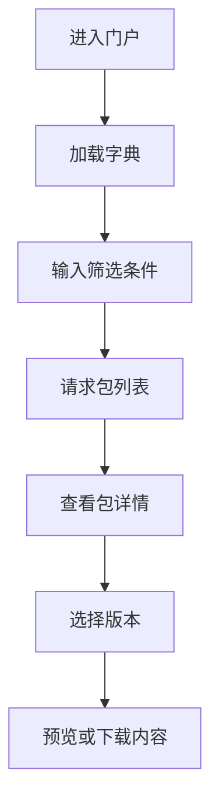
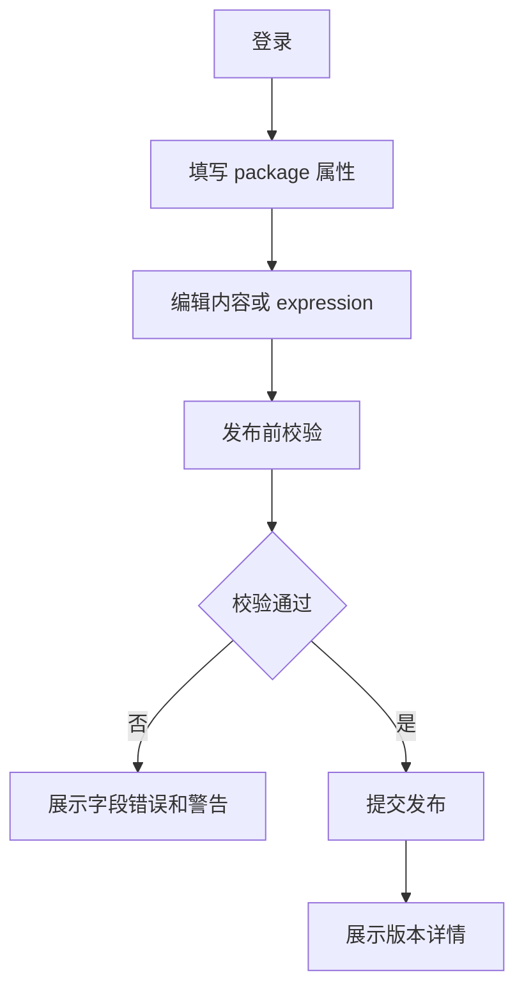
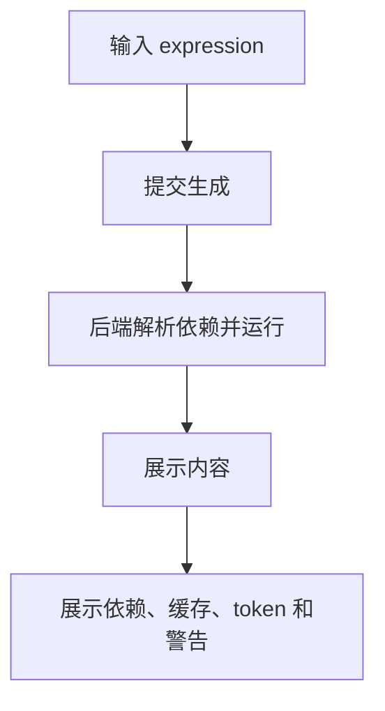

# 用户端门户设计

## 概述

用户端门户是 prompts-glue 面向普通用户和开发者的 Web 应用，用于搜索、浏览、查看、制作、实时生成、发布和下载提示词包。用户端门户通过后端服务 API 获取数据，不直接访问数据库或本地 repository。

用户端目录统一命名为 `web/`。历史描述中的 `portal` 均表示用户端门户，后续文档和实现以 `web` 为准。

## 设计目标

- 提供提示词包发现、查看、下载和发布的图形界面。
- 支持普通提示词和复合提示词的制作与发布前校验。
- 支持实时 expression 生成提示词，并展示依赖、缓存和 token 信息。
- 通过后端字典 API 加载分类、状态、类型、缓存策略等编码。
- 与 CLI 和 Manager 共用 Registry API 语义，避免重复业务规则。
- 保持页面交互清晰、响应及时、错误可定位。

## 非目标

| 非目标 | 说明 |
|---|---|
| 本地 repository 管理 | 本地安装、卸载和文件写入由 CLI 负责 |
| 管理运营 | 用户、字典、风险、审计和服务配置由 Manager 负责 |
| 数据持久化 | 权威数据由后端服务保存 |
| 表达式核心执行 | 表达式解析和运行由后端服务复用 SDK 完成 |

## 页面结构

| 页面 | 说明 |
|---|---|
| 首页 | 展示搜索入口、推荐分类、最新发布和热门包 |
| 搜索结果 | 按关键词、分类、标签、作者、状态、类型筛选提示词包 |
| 包详情 | 展示包概要、版本列表、标签、分类、作者、下载统计；下载内容下拉提供 curl 包下载命令与正文 URL |
| 版本详情 | 展示版本元数据、依赖、表达式、计算记录和内容预览 |
| 提示词工作台 | 普通提示词 Markdown 所见即所得内容编辑；复合提示词拼图/文本双视图构建、执行生成、依赖关系图与可开关发布模式 |
| 登录 | 登录远程服务并保存当前会话状态 |
| 个人中心 | 查看当前用户、命名空间、已发布包和基础配置 |

## 用户流程

### 搜索与浏览

### 发布提示词

### 实时生成

缓存策略由服务端配置统一决定，不在生成界面选择。

## 数据来源

| 数据 | 来源 |
|---|---|
| 分类、状态、类型、缓存策略 | 后端字典 API |
| 包列表、包详情、版本内容 | Registry API |
| 登录用户和权限 | 认证 API |
| 实时生成结果 | Registry 生成 API |
| 发布校验和发布结果 | Registry 发布 API |

前端不得硬编码业务编码值。页面可保留布局、路由、组件状态等非业务编码常量。

## 状态管理

| 状态 | 说明 |
|---|---|
| 会话状态 | 当前用户、访问令牌、过期时间 |
| 字典状态 | 已加载字典分组、加载时间、启用项 |
| 查询状态 | 搜索条件、分页、排序和当前结果 |
| 表单状态 | 发布表单、实时生成表单和校验错误 |
| UI 状态 | 弹窗、Toast、侧边栏和主题偏好 |

访问令牌不得写入 URL，不应输出到控制台日志。

## 组件要求

| 组件 | 说明 |
|---|---|
| API Client | 统一处理响应结构、错误对象、认证头和 request_id |
| 字典选择器 | 基于字典 API 渲染分类、状态、类型等选择项 |
| 包卡片 | 展示包名、说明、分类、标签、最新版本 |
| 版本列表 | 展示版本号、状态、发布时间和废弃信息 |
| 内容预览 | 展示 Markdown 内容，避免执行不可信脚本 |
| Markdown 编辑器 | 普通提示词内容所见即所得编辑；存储与发布为 Markdown 原文 |
| 表单组件 | 展示字段错误、警告和提交状态 |
| 对话框组件 | 替代浏览器原生确认框 |
| Toast 组件 | 展示操作结果和 request_id |
| 统计组件 | 展示生成 token、缓存命中和下载趋势 |

## 交互规则

- 加载失败应展示可读错误信息和 `request_id`。
- 发布、生成、下载等操作应展示进行中状态，避免重复提交。
- 删除、废弃、清理等高影响操作必须使用 React 对话框确认。
- 禁止使用浏览器原生 `alert`、`confirm`、`prompt`。
- 内容预览应避免执行用户提供的 HTML 或脚本。
- 未登录用户访问发布页面时应引导登录。

## API 交互

| 功能 | API |
|---|---|
| 登录 | `/api/registry/auth/login` |
| 当前身份 | `/api/registry/auth/me` |
| 加载字典 | `/api/dicts`、`/api/dicts/{group}` |
| 搜索包 | `/api/registry/packages` |
| 查看包概要 | `/api/registry/packages/{name}` |
| 查看版本 | `/api/registry/packages/{name}/versions/{version}` |
| 下载内容 | `/api/registry/packages/{name}/versions/{version}/content`（默认 JSON 包；`format=raw` 仅正文） |
| 发布包 | `/api/registry/packages` |
| 依赖解析 | `/api/registry/dependencies/resolve` |
| 实时生成 | `/api/registry/generate` |

## 安全要求

- 不在前端代码中硬编码密钥、令牌或业务字典。
- 不将访问令牌拼接到 URL 查询参数。
- Markdown 预览应进行安全渲染，避免 XSS。
- 表单校验仅作为用户体验优化，后端仍是权威校验方。
- 错误信息不得展示敏感配置、令牌或内部调用栈。

## 可访问性与体验

- 表单控件应有明确标签和错误提示。
- 搜索和筛选状态应可被用户理解和清除。
- 列表分页应展示总数、当前页和是否还有更多。
- 长内容预览应支持复制、下载和折叠。
- 移动端应保持基本可用，重点页面采用响应式布局。

## 验证要求

| 验证 | 内容 |
|---|---|
| 类型检查 | 前端类型和 API 数据结构匹配 |
| 构建验证 | 生产构建成功且无硬编码业务字典 |
| 手动验证 | 搜索、详情、下载、登录、发布、实时生成流程 |
| 接口验证 | API Client 正确处理成功、失败、未认证和权限不足 |
| UI 验证 | 不使用浏览器原生对话框，错误和加载状态可见 |
