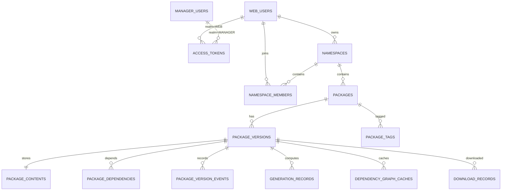

# Server 数据库设计

## 概述

Server 数据库用于支撑 prompts-glue 后端服务的提示词包注册、版本管理、依赖解析、搜索下载、实时生成、缓存、用户权限和审计能力。数据库保存服务端权威数据，CLI 本地 repository 只作为本地缓存和离线工作区，不替代 server 数据库。

数据库设计面向 MySQL 8，字段类型以通用数据类型描述。具体实现可根据 ORM 和数据库方言映射为实际列类型。

## 设计目标

- 支持提示词包、版本、内容、依赖和计算记录的可追溯管理。
- 支持公开包、私有包、命名空间和维护权限控制。
- 支持按包名、描述、分类、标签、作者和状态搜索。
- 支持复合提示词依赖解析、反向依赖查找和缓存失效判断。
- 支持实时生成请求、token 用量、缓存命中和审计记录。
- 支持管理端对包、版本、用户、字典和风险内容进行运营管理。

## 数据分组

| 分组 | 说明 |
|---|---|
| 账号与权限 | 用户、访问令牌、命名空间、成员和权限 |
| 提示词包 | 包概要、版本、内容、标签、依赖和版本事件 |
| 表达式与计算 | 依赖图、计算记录、生成记录和缓存 |
| 字典与配置 | 服务端统一管理的分类、状态、执行方式等字典值 |
| 审计与安全 | 操作审计、下载记录、访问统计和风险标记 |

## 通用字段约定

除纯关系表外，业务表应包含以下通用字段。

| 字段 | 类型 | 必填 | 说明 |
|---|---|---|---|
| id | 字符串 | 是 | 全局唯一标识 |
| created_at | UTC 时间 | 是 | 创建时间 |
| updated_at | UTC 时间 | 是 | 最近更新时间 |
| deleted_at | UTC 时间 | 否 | 软删除时间，未删除为空 |

对外可见的资源不应直接依赖自增数值作为唯一标识。包名、版本号、命名空间名称等业务唯一字段应建立唯一约束。

## 账号与权限

系统将用户按使用域拆为两组物理表：web 用户表（`users`）承载 web 门户与 registry API 的使用者；管理用户表（`manager_users`）承载管理界面运营员工。两组用户各自登录、各自签发访问令牌，令牌按 realm 标识所属域。web 用户只能访问 web 与 registry API，manager 用户只能访问管理 API，边界由令牌 realm 与中间件共同保证。

### Web 用户表

保存 web 域用户主体，使用 web 门户与 registry API。

| 字段 | 类型 | 必填 | 说明 |
|---|---|---|---|
| id | 字符串 | 是 | 用户标识 |
| username | 字符串 | 是 | 用户名，唯一 |
| email | 字符串 | 否 | 邮箱，非空时唯一（空邮箱存为 NULL，不参与唯一性比较），可用于登录 |
| display_name | 字符串 | 否 | 展示名称 |
| password_hash | 字符串 | 否 | 密码摘要，本地来源用户必填；LDAP 来源用户为空（凭据由目录校验） |
| status | 账号状态 | 是 | 取值见 dicts.md 中的”账号状态” |
| source | 账号来源 | 是 | 取值见 dicts.md 中的”账号来源”（LOCAL/LDAP/WEB） |
| external_id | 字符串 | 否 | 外部身份标识，LDAP 来源为用户 DN |
| last_login_at | UTC 时间 | 否 | 最近登录时间 |
| created_at | UTC 时间 | 是 | 创建时间 |
| updated_at | UTC 时间 | 是 | 更新时间 |
| deleted_at | UTC 时间 | 否 | 软删除时间 |

web 用户授权由资源归属与命名空间成员决定，不持有全局角色字段。

约束与索引：

| 类型 | 字段 | 说明 |
|---|---|---|
| 唯一约束 | username | 用户名唯一 |
| 唯一约束 | email | 邮箱非空时唯一 |
| 普通索引 | status | 支持管理端按状态筛选 |
| 普通索引 | source, external_id | LDAP 同步按外部身份幂等 upsert |

### 管理用户表

保存 manager 域用户主体，仅使用管理界面。

| 字段 | 类型 | 必填 | 说明 |
|---|---|---|---|
| id | 字符串 | 是 | 用户标识 |
| username | 字符串 | 是 | 用户名，唯一 |
| email | 字符串 | 否 | 邮箱，非空时唯一 |
| display_name | 字符串 | 否 | 展示名称 |
| password_hash | 字符串 | 否 | 密码摘要，本地来源用户必填 |
| status | 账号状态 | 是 | 取值见 dicts.md 中的”账号状态” |
| source | 账号来源 | 是 | 取值 LOCAL/LDAP（管理用户不支持 web 自注册来源） |
| external_id | 字符串 | 否 | 外部身份标识，LDAP 来源为用户 DN |
| role | 管理角色 | 是 | 取值见 dicts.md 中的”管理角色”（默认 ADMIN） |
| last_login_at | UTC 时间 | 否 | 最近登录时间 |
| created_at | UTC 时间 | 是 | 创建时间 |
| updated_at | UTC 时间 | 是 | 更新时间 |
| deleted_at | UTC 时间 | 否 | 软删除时间 |

约束与索引：

| 类型 | 字段 | 说明 |
|---|---|---|
| 唯一约束 | username | 用户名唯一 |
| 唯一约束 | email | 邮箱非空时唯一 |
| 普通索引 | status | 按状态筛选 |
| 普通索引 | source, external_id | LDAP 同步幂等 upsert |
| 普通索引 | role | 按管理角色筛选 |

### 访问令牌表

保存 CLI、Web、Manager 访问 server 的认证凭据摘要。令牌按 realm 绑定所属用户表，中间件据此校验跨域访问。

| 字段 | 类型 | 必填 | 说明 |
|---|---|---|---|
| id | 字符串 | 是 | 令牌记录标识 |
| user_id | 字符串 | 是 | 所属用户，按 realm 指向 web 用户表或管理用户表 |
| realm | 令牌域 | 是 | 取值 WEB/MANAGER，决定 user_id 指向哪张表 |
| token_hash | 字符串 | 是 | 令牌摘要，不保存明文令牌 |
| name | 字符串 | 否 | 令牌名称或设备说明 |
| scopes | 字符串列表 | 否 | 授权范围 |
| expires_at | UTC 时间 | 否 | 过期时间 |
| revoked_at | UTC 时间 | 否 | 吊销时间 |
| last_used_at | UTC 时间 | 否 | 最近使用时间 |
| created_at | UTC 时间 | 是 | 创建时间 |

约束与索引：

| 类型 | 字段 | 说明 |
|---|---|---|
| 唯一约束 | token_hash | 防止重复令牌 |
| 普通索引 | user_id | 查询用户令牌 |
| 普通索引 | realm | 按域筛选 |
| 普通索引 | expires_at | 清理过期令牌 |

### 角色表

管理端 RBAC 角色，承载一组权限并分配给 manager 用户。

| 字段 | 类型 | 必填 | 说明 |
|---|---|---|---|
| id | 字符串 | 是 | 角色标识 |
| code | 字符串 | 是 | 角色编码，唯一（如 admin） |
| name | 字符串 | 是 | 角色名称 |
| description | 字符串 | 否 | 说明 |
| enabled | 布尔值 | 是 | 是否启用 |
| system | 布尔值 | 是 | 内置角色不可删除 |
| created_at / updated_at / deleted_at | UTC 时间 | 是/是/否 | 通用字段 |

### 权限表

按 `资源:动作` 编码的权限项，按 group 分组。

| 字段 | 类型 | 必填 | 说明 |
|---|---|---|---|
| id | 字符串 | 是 | 权限标识 |
| code | 字符串 | 是 | 权限编码，唯一（如 user:write） |
| name | 字符串 | 是 | 权限名称 |
| group | 字符串 | 是 | 分组（如 user、role） |
| sort_order | 数值 | 是 | 排序 |

### 角色权限表 / 角色成员表

角色权限（role_id + permission_id 复合唯一）与角色成员（role_id + user_id 复合唯一，user_id 指向 manager_users）。manager 用户的权限为其所有角色权限的并集。

### 命名空间表

命名空间用于组织或个人作用域包，例如 `@scope/name` 中的 scope。

| 字段 | 类型 | 必填 | 说明 |
|---|---|---|---|
| id | 字符串 | 是 | 命名空间标识 |
| name | 字符串 | 是 | 命名空间名称，唯一 |
| display_name | 字符串 | 否 | 展示名称 |
| owner_user_id | 字符串 | 是 | 默认拥有者 |
| visibility | 资源可见性 | 是 | 取值见 dicts.md 中的“资源可见性” |
| description | 字符串 | 否 | 命名空间说明 |
| created_at | UTC 时间 | 是 | 创建时间 |
| updated_at | UTC 时间 | 是 | 更新时间 |
| deleted_at | UTC 时间 | 否 | 软删除时间 |

约束与索引：

| 类型 | 字段 | 说明 |
|---|---|---|
| 唯一约束 | name | 命名空间唯一 |
| 普通索引 | owner_user_id | 查询用户拥有的命名空间 |
| 普通索引 | visibility | 按可见性筛选 |

### 命名空间成员表

保存用户在命名空间内的角色。

| 字段 | 类型 | 必填 | 说明 |
|---|---|---|---|
| id | 字符串 | 是 | 成员记录标识 |
| namespace_id | 字符串 | 是 | 命名空间 |
| user_id | 字符串 | 是 | 用户 |
| role | 命名空间角色 | 是 | 取值见 dicts.md 中的“命名空间角色” |
| created_at | UTC 时间 | 是 | 创建时间 |
| updated_at | UTC 时间 | 是 | 更新时间 |

约束与索引：

| 类型 | 字段 | 说明 |
|---|---|---|
| 唯一约束 | namespace_id, user_id | 同一用户在同一命名空间只有一个成员身份 |
| 普通索引 | user_id | 查询用户所属命名空间 |
| 普通索引 | role | 管理端按角色筛选 |

## 提示词包

### 包表

保存提示词包的跨版本概要信息。每个包名在一个命名空间下唯一。

| 字段 | 类型 | 必填 | 说明 |
|---|---|---|---|
| id | 字符串 | 是 | 包标识 |
| namespace_id | 字符串 | 否 | 所属命名空间，无作用域包可为空 |
| name | 字符串 | 是 | 完整包名，包含可选 scope |
| short_name | 字符串 | 是 | 不含 scope 的包名 |
| description | 字符串 | 是 | 包说明 |
| category | 提示词分类 | 是 | 取值见 dicts.md |
| visibility | 资源可见性 | 是 | 取值见 dicts.md 中的“资源可见性” |
| latest_version | 字符串 | 否 | 最新可用发布版本 |
| owner_user_id | 字符串 | 是 | 包拥有者 |
| star_count | 数值 | 是 | 收藏数（包级聚合，所有版本共享） |
| created_at | UTC 时间 | 是 | 创建时间 |
| updated_at | UTC 时间 | 是 | 更新时间 |
| deleted_at | UTC 时间 | 否 | 软删除时间 |

### 包收藏表

记录用户对包的收藏关系，同一用户对同一包仅一条。

| 字段 | 类型 | 必填 | 说明 |
|---|---|---|---|
| id | 字符串 | 是 | 收藏记录标识 |
| package_id | 字符串 | 是 | 收藏的包；与 user_id 构成唯一索引 |
| user_id | 字符串 | 是 | 收藏用户；与 package_id 构成唯一索引 |
| created_at | UTC 时间 | 是 | 收藏时间 |

约束与索引：

| 类型 | 字段 | 说明 |
|---|---|---|
| 唯一约束 | name | 包名全局唯一 |
| 普通索引 | namespace_id, short_name | 命名空间内查询 |
| 普通索引 | category, visibility | 分类浏览和可见性过滤 |
| 普通索引 | owner_user_id | 查询用户维护的包 |
| 全文索引 | name, description | 搜索包名和说明 |

### 包版本表

保存每个提示词包版本的元数据和状态。

| 字段 | 类型 | 必填 | 说明 |
|---|---|---|---|
| id | 字符串 | 是 | 版本标识 |
| package_id | 字符串 | 是 | 所属包 |
| version | 字符串 | 是 | 语义化版本 |
| status | 版本状态 | 是 | 取值见 dicts.md |
| type | 提示词类型 | 是 | 取值见 dicts.md |
| description | 字符串 | 是 | 当前版本说明 |
| expression | 字符串 | 否 | 复合提示词表达式 |
| content_checksum | 字符串 | 是 | 内容摘要 |
| dependency_checksum | 字符串 | 否 | 依赖解析摘要 |
| compute_timing | 提示词计算时机 | 否 | 取值见 dicts.md |
| cache_strategy | 提示词缓存策略 | 否 | 取值见 dicts.md |
| token_input | 数值 | 否 | 最近一次计算输入 token |
| token_output | 数值 | 否 | 最近一次计算输出 token |
| token_total | 数值 | 否 | 最近一次计算总 token |
| created_by | 字符串 | 是 | 创建用户 |
| published_by | 字符串 | 否 | 发布用户 |
| published_at | UTC 时间 | 否 | 发布时间 |
| deprecated_at | UTC 时间 | 否 | 废弃时间 |
| deprecated_reason | 字符串 | 否 | 废弃原因 |
| replacement | 字符串 | 否 | 替代包或版本建议 |
| created_at | UTC 时间 | 是 | 创建时间 |
| updated_at | UTC 时间 | 是 | 更新时间 |
| deleted_at | UTC 时间 | 否 | 软删除时间 |

约束与索引：

| 类型 | 字段 | 说明 |
|---|---|---|
| 唯一约束 | package_id, version | 同一包版本不可重复 |
| 普通索引 | package_id, status | 查询包的可用版本 |
| 普通索引 | type | 按提示词类型筛选 |
| 普通索引 | published_at | 按发布时间排序 |
| 普通索引 | created_by | 查询用户创建的版本 |

### 包内容表

保存版本对应的 Markdown 内容体。内容可与版本元数据分离，便于内容校验、审计和大字段管理。

| 字段 | 类型 | 必填 | 说明 |
|---|---|---|---|
| id | 字符串 | 是 | 内容记录标识 |
| package_version_id | 字符串 | 是 | 所属版本 |
| content | 长文本 | 是 | Markdown 内容体 |
| readme | 长文本 | 否 | 包说明内容 |
| checksum | 字符串 | 是 | 内容摘要 |
| size_bytes | 数值 | 是 | 内容大小 |
| created_at | UTC 时间 | 是 | 创建时间 |
| updated_at | UTC 时间 | 是 | 更新时间 |

约束与索引：

| 类型 | 字段 | 说明 |
|---|---|---|
| 唯一约束 | package_version_id | 一个版本只有一份当前内容 |
| 普通索引 | checksum | 内容完整性校验和重复内容识别 |

### 包标签表

保存包级标签，支持检索和推荐。

| 字段 | 类型 | 必填 | 说明 |
|---|---|---|---|
| id | 字符串 | 是 | 标签记录标识 |
| package_id | 字符串 | 是 | 所属包 |
| tag | 字符串 | 是 | 标签值 |
| normalized_tag | 字符串 | 是 | 规范化标签 |
| created_at | UTC 时间 | 是 | 创建时间 |

约束与索引：

| 类型 | 字段 | 说明 |
|---|---|---|
| 唯一约束 | package_id, normalized_tag | 同一包标签不重复 |
| 普通索引 | normalized_tag | 按标签搜索 |

### 包依赖表

保存版本表达式解析出的直接依赖。间接依赖可通过递归查询或依赖图缓存获得。

| 字段 | 类型 | 必填 | 说明 |
|---|---|---|---|
| id | 字符串 | 是 | 依赖记录标识 |
| package_version_id | 字符串 | 是 | 依赖方版本 |
| dependency_package_name | 字符串 | 是 | 被依赖包名 |
| dependency_package_id | 字符串 | 否 | 被依赖包标识，未解析时可为空 |
| version_rule | 版本选择规则 | 否 | 表达式中声明的版本规则 |
| resolved_version | 字符串 | 否 | 发布或计算时实际解析版本 |
| resolved_package_version_id | 字符串 | 否 | 实际依赖版本标识 |
| optional | 布尔值 | 是 | 是否允许缺失 |
| affects_compute | 布尔值 | 是 | 依赖变化是否影响重新计算 |
| position_start | 数值 | 否 | 表达式引用起始位置 |
| position_end | 数值 | 否 | 表达式引用结束位置 |
| created_at | UTC 时间 | 是 | 创建时间 |
| updated_at | UTC 时间 | 是 | 更新时间 |

约束与索引：

| 类型 | 字段 | 说明 |
|---|---|---|
| 普通索引 | package_version_id | 查询版本直接依赖 |
| 普通索引 | dependency_package_id | 查询反向依赖 |
| 普通索引 | resolved_package_version_id | 精确版本反向依赖和缓存失效 |
| 普通索引 | dependency_package_name, version_rule | 版本规则解析和错误定位 |

### 版本事件表

记录版本创建、发布、废弃、重新计算等生命周期事件。

| 字段 | 类型 | 必填 | 说明 |
|---|---|---|---|
| id | 字符串 | 是 | 事件标识 |
| package_version_id | 字符串 | 是 | 相关版本 |
| event_type | 包版本事件类型 | 是 | 取值见 dicts.md 中的“包版本事件类型” |
| actor_user_id | 字符串 | 否 | 操作用户 |
| message | 字符串 | 否 | 事件说明 |
| metadata | 映射 | 否 | 依赖、缓存、审核等补充信息 |
| created_at | UTC 时间 | 是 | 事件时间 |

约束与索引：

| 类型 | 字段 | 说明 |
|---|---|---|
| 普通索引 | package_version_id, created_at | 查询版本时间线 |
| 普通索引 | event_type | 管理端筛选事件 |
| 普通索引 | actor_user_id | 查询用户操作 |

## 表达式与计算

### 生成记录表

记录实时生成和复合提示词计算过程。

| 字段 | 类型 | 必填 | 说明 |
|---|---|---|---|
| id | 字符串 | 是 | 生成记录标识 |
| request_user_id | 字符串 | 否 | 请求用户，匿名请求为空 |
| package_version_id | 字符串 | 否 | 关联包版本，实时生成可为空 |
| expression | 字符串 | 是 | 本次计算表达式 |
| expression_hash | 字符串 | 是 | 表达式摘要 |
| input_hash | 字符串 | 否 | 调用方输入摘要 |
| result_checksum | 字符串 | 否 | 生成结果摘要 |
| cache_hit | 布尔值 | 是 | 是否命中缓存 |
| cache_key | 字符串 | 否 | 缓存键摘要 |
| error_code | 字符串 | 否 | 失败错误码 |
| error_message | 字符串 | 否 | 失败说明 |
| token_input | 数值 | 否 | 输入 token |
| token_output | 数值 | 否 | 输出 token |
| token_total | 数值 | 否 | 总 token |
| model_name | 字符串 | 否 | 使用的模型名称 |
| duration_ms | 数值 | 否 | 计算耗时 |
| created_at | UTC 时间 | 是 | 创建时间 |

约束与索引：

| 类型 | 字段 | 说明 |
|---|---|---|
| 普通索引 | request_user_id, created_at | 查询用户生成历史 |
| 普通索引 | package_version_id, created_at | 查询版本计算历史 |
| 普通索引 | expression_hash | 查找相同表达式生成记录 |
| 普通索引 | cache_key | 分析缓存命中 |
| 普通索引 | error_code | 统计失败类型 |

### 计算缓存表

保存表达式计算结果缓存。缓存内容只保存可缓存请求的结果，敏感输入不进入共享缓存。

| 字段 | 类型 | 必填 | 说明 |
|---|---|---|---|
| id | 字符串 | 是 | 缓存记录标识 |
| cache_key | 字符串 | 是 | 缓存键 |
| cache_strategy | 提示词缓存策略 | 是 | 取值见 dicts.md |
| expression_hash | 字符串 | 是 | 表达式摘要 |
| dependency_checksum | 字符串 | 是 | 依赖解析摘要 |
| context_hash | 字符串 | 否 | 上下文摘要 |
| result_content | 长文本 | 是 | 缓存结果 |
| result_checksum | 字符串 | 是 | 结果摘要 |
| token_input | 数值 | 否 | 首次生成输入 token |
| token_output | 数值 | 否 | 首次生成输出 token |
| token_total | 数值 | 否 | 首次生成总 token |
| hit_count | 数值 | 是 | 命中次数 |
| expires_at | UTC 时间 | 否 | 过期时间 |
| last_hit_at | UTC 时间 | 否 | 最近命中时间 |
| created_at | UTC 时间 | 是 | 创建时间 |
| updated_at | UTC 时间 | 是 | 更新时间 |

约束与索引：

| 类型 | 字段 | 说明 |
|---|---|---|
| 唯一约束 | cache_key | 缓存键唯一 |
| 普通索引 | expression_hash | 按表达式清理缓存 |
| 普通索引 | dependency_checksum | 依赖变化后定位缓存 |
| 普通索引 | expires_at | 清理过期缓存 |
| 普通索引 | last_hit_at | 缓存淘汰策略 |

### 依赖图缓存表

保存版本的完整依赖图摘要，便于快速展示、循环检测和缓存失效判断。

| 字段 | 类型 | 必填 | 说明 |
|---|---|---|---|
| id | 字符串 | 是 | 依赖图记录标识 |
| package_version_id | 字符串 | 是 | 所属版本 |
| graph_checksum | 字符串 | 是 | 图摘要 |
| graph_data | 映射 | 是 | 直接和间接依赖图 |
| max_depth | 数值 | 是 | 依赖最大深度 |
| has_cycle | 布尔值 | 是 | 是否存在循环 |
| cycle_path | 字符串列表 | 否 | 循环路径 |
| created_at | UTC 时间 | 是 | 创建时间 |
| updated_at | UTC 时间 | 是 | 更新时间 |

约束与索引：

| 类型 | 字段 | 说明 |
|---|---|---|
| 唯一约束 | package_version_id | 每个版本一份当前依赖图缓存 |
| 普通索引 | graph_checksum | 判断依赖图是否变化 |
| 普通索引 | has_cycle | 管理端发现异常依赖 |

## 字典与配置

### 数据字典表

保存服务端统一管理的字典项。前端所有编码应通过后端字典 API 加载。

| 字段 | 类型 | 必填 | 说明 |
|---|---|---|---|
| id | 字符串 | 是 | 字典项标识 |
| group | 字符串 | 是 | 字典分组 |
| value | 字符串 | 是 | 字典值 |
| label | 字符串 | 是 | 展示名称 |
| description | 字符串 | 否 | 说明 |
| sort_order | 数值 | 是 | 排序 |
| enabled | 布尔值 | 是 | 是否启用 |
| system | 布尔值 | 是 | 是否系统内置 |
| created_at | UTC 时间 | 是 | 创建时间 |
| updated_at | UTC 时间 | 是 | 更新时间 |

约束与索引：

| 类型 | 字段 | 说明 |
|---|---|---|
| 唯一约束 | group, value | 同组字典值唯一 |
| 普通索引 | group, enabled | 前端按分组加载启用项 |

### 服务配置表

保存可由管理端维护的服务级配置，例如缓存有效期、生成限制、审核开关等。

| 字段 | 类型 | 必填 | 说明 |
|---|---|---|---|
| id | 字符串 | 是 | 配置标识 |
| key | 字符串 | 是 | 配置键 |
| value | 字符串 | 是 | 配置值 |
| value_type | 值类型 | 是 | 取值见 dicts.md |
| description | 字符串 | 否 | 配置说明 |
| encrypted | 布尔值 | 是 | 是否加密保存 |
| updated_by | 字符串 | 否 | 最近修改用户 |
| created_at | UTC 时间 | 是 | 创建时间 |
| updated_at | UTC 时间 | 是 | 更新时间 |

约束与索引：

| 类型 | 字段 | 说明 |
|---|---|---|
| 唯一约束 | key | 配置键唯一 |
| 普通索引 | updated_by | 审计配置变更来源 |

## 审计与安全

### 审计日志表

记录重要写操作和安全相关操作。

| 字段 | 类型 | 必填 | 说明 |
|---|---|---|---|
| id | 字符串 | 是 | 审计记录标识 |
| actor_user_id | 字符串 | 否 | 操作用户，系统任务可为空 |
| action | 审计操作类型 | 是 | 取值见 dicts.md 中的“审计操作类型” |
| resource_type | 字符串 | 是 | 资源类型 |
| resource_id | 字符串 | 否 | 资源标识 |
| request_id | 字符串 | 否 | 请求追踪标识 |
| ip_address | 字符串 | 否 | 请求 IP |
| user_agent | 字符串 | 否 | 客户端标识 |
| before_data | 映射 | 否 | 变更前摘要 |
| after_data | 映射 | 否 | 变更后摘要 |
| result | 操作结果 | 是 | 取值见 dicts.md 中的“操作结果” |
| message | 字符串 | 否 | 结果说明 |
| created_at | UTC 时间 | 是 | 操作时间 |

约束与索引：

| 类型 | 字段 | 说明 |
|---|---|---|
| 普通索引 | actor_user_id, created_at | 查询用户操作 |
| 普通索引 | resource_type, resource_id | 查询资源审计 |
| 普通索引 | action, created_at | 管理端按操作类型筛选 |
| 普通索引 | request_id | 请求链路追踪 |

### 下载记录表

记录提示词包下载和查看内容行为，用于统计和风控。包的下载量（包级）由本表按包聚合各版本下载记录得出（不缓存到包表）。

| 字段 | 类型 | 必填 | 说明 |
|---|---|---|---|
| id | 字符串 | 是 | 下载记录标识 |
| package_version_id | 字符串 | 是 | 下载版本 |
| user_id | 字符串 | 否 | 下载用户，匿名为空 |
| channel | 提示词下载渠道 | 是 | 取值见 dicts.md |
| ip_address | 字符串 | 否 | 请求 IP |
| user_agent | 字符串 | 否 | 客户端标识 |
| created_at | UTC 时间 | 是 | 下载时间 |

约束与索引：

| 类型 | 字段 | 说明 |
|---|---|---|
| 普通索引 | package_version_id, created_at | 统计版本下载量 |
| 普通索引 | user_id, created_at | 查询用户下载历史 |
| 普通索引 | channel, created_at | 按渠道统计 |

### 风险标记表

记录违规、过期、敏感或存在风险的包和版本。

| 字段 | 类型 | 必填 | 说明 |
|---|---|---|---|
| id | 字符串 | 是 | 风险标记标识 |
| resource_type | 字符串 | 是 | 标记资源类型 |
| resource_id | 字符串 | 是 | 标记资源标识 |
| risk_type | 风险类型 | 是 | 取值见 dicts.md 中的“风险类型” |
| severity | 风险等级 | 是 | 取值见 dicts.md 中的“风险等级” |
| reason | 字符串 | 是 | 标记原因 |
| status | 风险处理状态 | 是 | 取值见 dicts.md 中的“风险处理状态” |
| reporter_user_id | 字符串 | 否 | 标记者 |
| handled_by | 字符串 | 否 | 处理人 |
| handled_at | UTC 时间 | 否 | 处理时间 |
| created_at | UTC 时间 | 是 | 创建时间 |
| updated_at | UTC 时间 | 是 | 更新时间 |

约束与索引：

| 类型 | 字段 | 说明 |
|---|---|---|
| 普通索引 | resource_type, resource_id | 查询资源风险 |
| 普通索引 | risk_type, severity | 风险分类处理 |
| 普通索引 | status, created_at | 管理端待处理列表 |

## 关系概览

## 数据一致性规则

- 发布版本不可覆盖；相同 `package_id` 和 `version` 必须唯一。
- `PUBLISHED` 版本应具备完整内容、内容摘要、分类、类型和创建者。
- `COMPOSITE` 版本必须保存 expression，并根据 expression 生成依赖记录。
- 服务端发布时不得信任客户端传入的 dependencies，应重新解析后写入包依赖表。
- 包的 `latest_version` 只指向可用的已发布版本，废弃版本不应成为默认最新版本。
- 版本废弃不删除历史内容，也不破坏精确版本依赖的可复现性。
- 依赖包发布新版本或状态变更后，应基于包依赖表和依赖图缓存判断受影响缓存。
- 删除用户、命名空间、包和版本应优先软删除，避免破坏审计和历史依赖。

## 数据保留与清理

| 数据 | 保留策略 |
|---|---|
| 用户、命名空间、包、版本 | 长期保留，删除时软删除 |
| 包内容 | 发布后长期保留，草稿可按策略清理 |
| 生成记录 | 按审计和成本分析需要保留，超过期限可归档 |
| 计算缓存 | 按缓存策略、过期时间、容量和依赖变化清理 |
| 访问令牌 | 过期或吊销后保留摘要一段时间用于审计，再归档或清理 |
| 审计日志 | 长期保留或按合规要求归档 |
| 下载记录 | 用于统计和风控，可按周期聚合后归档 |

## 安全要求

- 访问令牌只保存摘要，不保存明文。
- 密码只保存安全摘要，不保存明文密码。
- 配置中如包含密钥，应加密保存并限制管理端展示。
- 审计日志和错误信息不得保存令牌、密钥、完整敏感输入或内部调用栈。
- 私有包的查询、下载、生成和依赖解析必须校验用户权限。
- 实时生成记录中只保存输入摘要，不默认保存完整用户输入。
- 缓存内容不得保存调用方标记为敏感或不可缓存的输入结果。

## 迁移与扩展

- 数据库结构应支持自动迁移，但生产环境迁移前应输出变更预览。
- 新增字典值优先写入数据字典表，并同步更新 docs/design/dicts.md。
- 新增提示词制作指令不应修改核心包表结构，应通过字典、指令配置和计算记录扩展。
- 大体量内容或高频缓存可拆分到专用存储，但数据库仍保存摘要、索引和审计信息。
