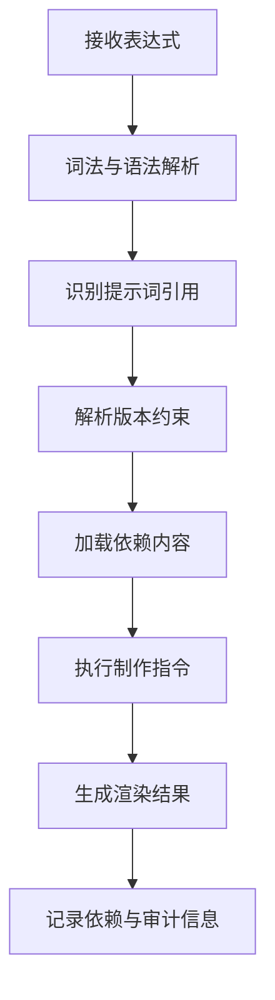

# 提示词制作规则

## 概述

提示词制作规则定义提示词包的命名、分类、版本、表达式、生成结果、存储和分发方式。该规则用于支持普通提示词的人工制作与发布，也支持实时提示词通过表达式即时组合生成。

提示词制作的目标是让提示词像可版本化的包一样被创建、组合、发布、搜索、下载和升级，减少不同 Agent 客户端与项目之间重复编写提示词的成本。

## 设计目标

- 提示词可被独立命名、分类、标注和版本化管理。
- 提示词可通过表达式组合已有提示词、文本片段和制作指令。
- 普通提示词与实时提示词使用同一套表达式规则。
- 提示词发布后可被搜索、查看、下载、安装和升级。
- 提示词依赖关系可追踪，组合结果可复现。
- 提示词规则保持与具体 Agent 客户端、模型和编程语言无关。

## 核心概念

| 概念　　　　 | 说明　　　　　　　　　　　　　　　　　　　　　　　　　　　　　　 |
| --------------| ------------------------------------------------------------------|
| 提示词包　　 | 一个可发布、可下载、可版本化的提示词单元，包含元数据和提示词内容 |
| 普通提示词　 | 由用户在界面或文件中编辑并发布的提示词包　　　　　　　　　　　　 |
| 实时提示词　 | 调用方提交表达式后即时生成结果的提示词，不要求先保存为包　　　　 |
| 提示词表达式 | 描述提示词引用、组合和制作指令调用的声明式规则　　　　　　　　　 |
| 制作指令　　 | 对一个或多个输入内容执行摘要、合并、清洗、提取等语义加工的规则　 |
| 依赖关系　　 | 表达式中引用的其他提示词包及其版本约束　　　　　　　　　　　　　 |
| 渲染结果　　 | 表达式解析、依赖加载和制作指令执行后生成的最终提示词内容　　　　 |

## 提示词类型

提示词类型取值见 [dicts.md](dicts.md) 中的“提示词类型”定义。

| 类型 | 设计要求 |
|---|---|
| 普通提示词 | 必须具备包名、版本、分类、状态和内容，可被发布、搜索、下载和安装 |
| 复合提示词 | 必须保存表达式和依赖关系，内容为表达式计算后的结果 |
| 实时提示词 | 必须提交表达式或原始内容，系统即时返回结果，可选择另存为普通提示词 |

## 包命名规则

提示词包名用于唯一标识提示词，应满足以下规则：

- 使用小写字母、数字、连字符或下划线，推荐使用连字符。
- 不允许包含点号、空格、特殊字符或大写字母。
- 不允许以点号或下划线开头。
- 长度不超过 214 个字符。
- 组织或作用域包使用 `@scope/name` 形式。
- 包名应见名知意，避免使用过于通用的名称。
- 同一作用域下包名必须唯一。

包名只表达提示词身份，不表达版本、状态或安装位置。

## 分类与标签

提示词分类取值见 [dicts.md](dicts.md) 中的“提示词分类”定义。

- 每个提示词包应选择一个主分类，用于导航、筛选和推荐。
- 标签用于补充描述适用场景、技术栈、角色、业务域等信息。
- 分类由系统统一管理，标签可由用户维护，但应在发布审核时做规范化处理。
- 搜索结果应同时支持按分类筛选和按标签匹配。

## 版本规则

提示词版本使用语义化版本：主版本号、次版本号、补丁版本号。

| 变更类型 | 版本影响 | 说明 |
|---|---|---|
| 重大变更 | 主版本号增加 | 输出结构、行为约束或依赖关系发生不兼容变化 |
| 能力增强 | 次版本号增加 | 新增内容、适用范围或组合能力，保持兼容 |
| 修正调整 | 补丁版本号增加 | 修复错别字、补充说明、优化表达，不改变使用方式 |

版本选择规则取值见 [dicts.md](dicts.md) 中的“版本选择规则”定义。

| 规则 | 设计语义 |
|---|---|
| 精确版本 | 只匹配指定版本 |
| 主版本兼容 | 匹配同一主版本下满足条件的最高版本 |
| 次版本兼容 | 匹配同一主版本和次版本下满足条件的最高版本 |
| 下限版本 | 匹配大于等于指定版本的最高可用版本 |
| 上限版本 | 匹配小于指定版本的最高可用版本 |
| 最新版本 | 匹配当前可用的最新发布版本 |

发布后的版本不可直接修改。需要调整时应创建新版本，历史版本保留只读并可追溯。

## 制作指令

制作指令取值见 [dicts.md](dicts.md) 中的“提示词制作指令”定义。

| 指令　　　 | 设计语义　　　　　　　　　　　　 | 输入　　　　　　　　 | 输出　　　　　　 |
| ------------| ----------------------------------| ----------------------| ------------------|
| 汇总　　　 | 将多个输入内容综合为一个完整结果 | 多段文本或提示词引用 | 综合后的文本　　 |
| 提取关键词 | 从输入中提取核心关键词　　　　　 | 文本　　　　　　　　 | 关键词列表或文本 |
| 标签　　　 | 根据输入生成标签　　　　　　　　 | 文本　　　　　　　　 | 标签列表　　　　 |
| 标注　　　 | 对输入增加分类、说明或结构化标记 | 文本　　　　　　　　 | 标注后的文本　　 |
| 摘要　　　 | 压缩输入内容并保留核心含义　　　 | 文本　　　　　　　　 | 摘要文本　　　　 |
| 合并　　　 | 按顺序拼接或融合多个输入　　　　 | 多段文本　　　　　　 | 合并文本　　　　 |
| 标题　　　 | 为输入生成标题　　　　　　　　　 | 文本　　　　　　　　 | 标题文本　　　　 |
| 要点　　　 | 将输入整理为要点列表　　　　　　 | 文本　　　　　　　　 | 要点文本　　　　 |
| 清洗　　　 | 移除噪声、重复格式和无效内容　　 | 文本　　　　　　　　 | 清洗后的文本　　 |
| 去重　　　 | 去除重复或近似重复内容　　　　　 | 多段文本　　　　　　 | 去重后的文本　　 |
| 主题　　　 | 提炼输入主题　　　　　　　　　　 | 文本　　　　　　　　 | 主题文本　　　　 |
| 大纲　　　 | 将输入整理为层级结构　　　　　　 | 文本　　　　　　　　 | 大纲文本　　　　 |
| 导语　　　 | 为输入生成开头说明　　　　　　　 | 文本　　　　　　　　 | 导语文本　　　　 |
| 问题　　　 | 基于输入生成问题清单　　　　　　 | 文本　　　　　　　　 | 问题列表或文本　 |
| 要素抽取　 | 从输入中提取指定要素　　　　　　 | 文本和要素要求　　　 | 要素集合或文本　 |
| 模板　　　 | 将输入套入指定结构　　　　　　　 | 文本和模板要求　　　 | 模板化文本　　　 |

制作指令只定义语义目标，不绑定具体模型或供应商。大部分制作指令需要调用 LLM 生成结果，少量指令可使用本地确定性规则完成。不同运行环境可采用不同实现，但相同输入、相同依赖版本和相同参数下应尽量保持结果可复现。

### 指令执行方式

制作指令执行方式取值见 [dicts.md](dicts.md) 中的“制作指令执行方式”定义。

| 指令 | 默认执行方式 | Token 消耗特征 |
|---|---|---|
| 汇总 | LLM | 输入通常包含多段提示词内容，输入和输出 token 消耗都较高 |
| 提取关键词 | LLM | 输入 token 取决于原文长度，输出 token 较低 |
| 标签 | LLM | 输入 token 取决于原文长度，输出 token 较低 |
| 标注 | LLM | 输入和输出 token 都随标注粒度增加 |
| 摘要 | LLM | 输入 token 较高，输出 token 受摘要长度约束 |
| 合并 | HYBRID | 简单拼接可本地完成，语义融合需要消耗 LLM token |
| 标题 | LLM | 输入 token 取决于原文长度，输出 token 较低 |
| 要点 | LLM | 输入 token 取决于原文长度，输出 token 中等 |
| 清洗 | HYBRID | 格式清洗可本地完成，语义清洗需要消耗 LLM token |
| 去重 | HYBRID | 精确去重可本地完成，语义去重需要消耗 LLM token |
| 主题 | LLM | 输入 token 取决于原文长度，输出 token 较低 |
| 大纲 | LLM | 输入 token 取决于原文长度，输出 token 中等 |
| 导语 | LLM | 输入 token 取决于原文长度，输出 token 较低 |
| 问题 | LLM | 输入 token 取决于原文长度，输出 token 取决于问题数量 |
| 要素抽取 | LLM | 输入 token 取决于原文长度和要素要求，输出 token 取决于要素数量 |
| 模板 | LLM | 输入 token 取决于原文和模板要求，输出 token 通常较高 |

系统应在执行前估算输入 token 和预期输出 token，并在执行后记录实际 token 消耗。实时提示词生成、批量生成和依赖链较长的复合提示词应优先结合缓存机制，避免重复消耗 token。

### 指令系统提示词

每个制作指令应配置稳定的系统提示词，用于约束 LLM 的角色、任务边界、输出格式和质量标准。系统提示词应作为指令配置的一部分进行版本化管理，变更后会影响缓存键和复合提示词的可复现性。

| 指令　　　 | 系统提示词　　　　　　　　　　　　　　　　　　　　　　　　　　　　　　　　　　　　　　　　　　　　　　　　　　　　　　　　　　　　　　　　　　　　　　　　　　　　　　　　 |
| ------------| ----------------------------------------------------------------------------------------------------------------------------------------------------------------------------|
| 汇总　　　 | 你是提示词内容整合助手。请综合所有输入内容，保留关键约束、目标、角色、流程和边界，去除冲突与重复，输出结构清晰、可直接使用的完整提示词。不得添加输入中没有依据的重要事实。 |
| 提取关键词 | 你是关键词提取助手。请从输入内容中提取最能代表主题、对象、动作、技术和约束的关键词，优先保留原文中的术语，去除泛化词和重复词，输出简洁关键词列表。　　　　　　　　　　　　 |
| 标签　　　 | 你是提示词标签生成助手。请根据输入内容生成适合检索、分类和推荐的标签，标签应短小、稳定、可复用，避免过细、重复或带有临时上下文的信息。　　　　　　　　　　　　　　　　　　 |
| 标注　　　 | 你是内容标注助手。请为输入内容增加清晰标注，标明主题、用途、适用场景、关键约束和注意事项。标注应帮助后续理解和检索，不改变原文核心含义。　　　　　　　　　　　　　　　　　 |
| 摘要　　　 | 你是摘要生成助手。请压缩输入内容并保留核心目标、关键规则、限制条件和结论。摘要应准确、简洁、层次清楚，不引入原文之外的信息。　　　　　　　　　　　　　　　　　　　　　　　 |
| 合并　　　 | 你是提示词合并助手。请按输入顺序合并内容，保留各部分有效信息，消除重复表达，处理明显冲突并说明取舍，输出连贯一致的提示词内容。　　　　　　　　　　　　　　　　　　　　　　 |
| 标题　　　 | 你是标题生成助手。请为输入内容生成简短、准确、可检索的标题。标题应体现核心主题和用途，避免夸张、含糊或过长。　　　　　　　　　　　　　　　　　　　　　　　　　　　　　　　 |
| 要点　　　 | 你是要点整理助手。请将输入内容整理为层次清楚的要点，保留关键动作、约束、决策和注意事项。要点应简洁、可执行、避免重复。　　　　　　　　　　　　　　　　　　　　　　　　　　 |
| 清洗　　　 | 你是文本清洗助手。请清理输入中的噪声、无效格式、重复符号和明显无关内容，保留有业务意义的信息。不得改变原文的关键意图和约束。　　　　　　　　　　　　　　　　　　　　　　　 |
| 去重　　　 | 你是内容去重助手。请识别完全重复和语义近似重复的内容，保留表达最完整、最准确的一项。输出应保持原有逻辑顺序，并尽量减少信息损失。　　　　　　　　　　　　　　　　　　　　　 |
| 主题　　　 | 你是主题提炼助手。请从输入内容中提炼核心主题，主题应准确反映主要对象、目标和适用范围，避免使用过宽泛的概念。　　　　　　　　　　　　　　　　　　　　　　　　　　　　　　　 |
| 大纲　　　 | 你是大纲生成助手。请将输入内容整理为层级清晰的大纲，体现主题、模块、步骤、规则和依赖关系。大纲应便于后续扩写为完整提示词。　　　　　　　　　　　　　　　　　　　　　　　　 |
| 导语　　　 | 你是导语生成助手。请为输入内容生成简短导语，说明背景、目标和使用方式。导语应自然、准确，并为后续正文建立清晰上下文。　　　　　　　　　　　　　　　　　　　　　　　　　　　 |
| 问题　　　 | 你是问题生成助手。请基于输入内容生成有助于澄清需求、发现风险或推进设计的问题。问题应具体、可回答，避免泛泛而谈。　　　　　　　　　　　　　　　　　　　　　　　　　　　　　 |
| 要素抽取　 | 你是要素抽取助手。请根据指定要素要求，从输入内容中抽取对应信息。输出应保持要素名称清晰、值准确；缺失要素应明确标记为未提供，不得编造。　　　　　　　　　　　　　　　　　　 |
| 模板　　　 | 你是提示词模板化助手。请按照指定模板组织输入内容，保留关键约束和语义关系。模板缺少的信息应保持空缺或标注未提供，不得虚构内容。　　　　　　　　　　　　　　　　　　　　　　 |

系统提示词应满足以下要求：

- 明确指令角色和输出目标。
- 要求保留输入中的关键约束和事实依据。
- 限制模型不得编造输入中不存在的重要信息。
- 约束输出格式，使结果便于缓存、比较、审阅和继续组合。
- 支持按指令版本调整，但发布后的历史版本应保留原系统提示词。

## 表达式规则

### 表达式组成

提示词表达式由以下元素组成：

| 元素 | 说明 |
|---|---|
| 提示词引用 | 引用某个提示词包，可附带版本约束 |
| 文本字面量 | 表达式中直接提供的文本输入 |
| 制作指令调用 | 对一个或多个参数执行制作指令 |
| 组合运算符 | 将多个提示词或指令结果组合成一个结果 |
| 指令参数 | 为制作指令补充目标、约束、主题或模板要求 |

### 提示词引用

提示词引用由包名和可选版本约束组成。未指定版本时，默认使用最新已发布版本。

| 形式 | 说明 |
|---|---|
| 包名 | 使用该包的最新已发布版本 |
| 包名@版本规则 | 使用满足版本规则的版本 |
| @作用域/包名@版本规则 | 使用指定作用域包及版本规则 |

引用解析时应校验包是否存在、版本规则是否可匹配、目标版本是否处于可用状态。

### 文本字面量

文本字面量用于在表达式中直接提供临时内容，常用于实时提示词或制作指令参数。

- 文本字面量不得包含密钥、令牌等敏感信息。
- 文本字面量只参与本次表达式计算，除非用户选择保存为提示词包。
- 文本字面量应保留原始文本语义，不应在解析阶段自动改写。

### 制作指令调用

制作指令调用由指令名称、输入参数和可选指令参数组成。

| 部分 | 必填 | 说明 |
|---|---|---|
| 指令名称 | 是 | 取值见 dicts.md 中的提示词制作指令 |
| 输入参数 | 否 | 提示词引用、文本字面量或嵌套指令调用 |
| 指令参数 | 否 | 对输出目标、风格、范围、约束的补充说明 |

指令调用可以嵌套。嵌套表达式应由内向外解析，内层结果作为外层输入。

### 组合运算符

组合运算符用于表达提示词之间的组合关系。

| 运算符 | 名称 | 设计语义 |
|---|---|---|
| `+` | 汇总组合 | 将左右两侧内容综合为一个结果，语义等同于汇总指令 |
| `|` | 合并组合 | 按左右顺序合并内容，语义等同于合并指令 |
| `#` | 标签组合 | 基于左侧内容生成或附加标签，语义等同于标签指令 |

当运算符与显式制作指令同时出现时，应按照表达式优先级和括号确定计算顺序。系统应在设计说明和用户界面中提示运算符对应的语义，避免将其理解为编程语言运算。

### 优先级

表达式优先级从高到低如下：

| 优先级 | 元素 |
|---|---|
| 最高 | 括号内表达式 |
| 高 | 制作指令调用 |
| 中 | 标签组合 |
| 中 | 汇总组合 |
| 低 | 合并组合 |

存在歧义时，应要求用户使用括号明确组合关系。

### 示例表达式

| 示例 | 说明 |
|---|---|
| `keys(base-prompt, "登录流程")` | 从基础提示词和临时文本中提取关键词 |
| `summary(project-rules@^1.2.0)` | 对满足版本规则的项目规则提示词生成摘要 |
| `frontend-rules | backend-rules` | 按顺序合并前端和后端规则 |
| `base-rules + summary(team-rules)` | 将基础规则与团队规则摘要进行汇总 |
| `template(api-design){"输出为评审清单"}` | 将接口设计提示词套入指定模板要求 |

## 表达式解析与执行

### 解析流程

### 依赖解析

- 表达式中的提示词引用应解析为确定的包名和版本。
- 复合提示词保存时应记录直接依赖列表。
- 依赖中的复合提示词应继续解析其依赖，形成完整依赖图。
- 依赖图不得出现循环引用。
- 当依赖版本被废弃时，应提示使用方升级，但不得破坏已发布版本的可复现性。

### 计算时机

提示词计算时机取值见 [dicts.md](dicts.md) 中的“提示词计算时机”定义。复合提示词应根据使用场景选择实时计算或延时计算。

| 计算时机 | 适用场景 | 设计要求 |
|---|---|---|
| 实时计算 | 对结果新鲜度要求高、依赖变更后需要尽快更新的复合提示词 | 一个提示词包发生新增版本、发布、废弃或内容变更后，系统应查找依赖该包的相关提示词，并根据版本选择规则判断是否受影响；受影响的提示词应立即重新计算结果并记录新的依赖解析结果 |
| 延时计算 | 对结果新鲜度要求不高、计算成本较高或依赖链较长的复合提示词 | 只有在提示词被查看、下载、安装、发布校验或被其他提示词引用时才触发计算；计算时应按依赖层级逐层解析并生成结果 |

实时计算应基于反向依赖关系识别受影响提示词。若依赖方的版本选择规则不会匹配变更后的版本，则不需要重新计算。若依赖方引用的是精确版本，只有该精确版本内容或状态发生影响可用性的变化时才重新计算。

延时计算应在单次计算过程中维护已解析包集合和计算结果缓存，避免同一依赖被重复计算。计算过程中发现循环引用时，应终止当前计算并返回依赖循环错误。

无论采用哪种计算时机，系统都应记录实际解析到的依赖版本、计算时间和计算结果状态，确保结果可追溯。

### 计算缓存

提示词缓存策略取值见 [dicts.md](dicts.md) 中的“提示词缓存策略”定义。计算缓存用于避免相同表达式、相同依赖版本和相同参数反复生成结果，特别是实时提示词的重复生成请求。

| 缓存对象 | 缓存键组成 | 设计要求 |
|---|---|---|
| 已发布复合提示词 | 包名、版本、表达式、依赖解析版本、计算参数 | 结果可长期复用；当表达式、依赖解析版本或提示词状态变化时失效 |
| 延时计算结果 | 包名、版本选择规则、依赖解析版本、计算参数 | 在按需计算时优先查询缓存；缓存命中时直接返回结果和依赖信息 |
| 实时生成结果 | 规范化表达式、文本字面量摘要、依赖解析版本、调用参数、调用方范围 | 使用短期缓存减少重复计算；缓存结果不得替代正式发布版本 |

缓存命中时应返回缓存结果、实际依赖版本和缓存生成时间。缓存未命中时，系统按表达式解析流程计算结果，并在计算成功后写入缓存。

实时生成提示词应优先使用短期缓存。相同表达式在短时间内重复请求时，若依赖版本、输入文本和调用参数未变化，应直接复用缓存结果。包含敏感内容、超大文本或不可缓存标记的实时请求不应写入共享缓存。

缓存失效应满足以下规则：

- 依赖包发布新版本后，使用非精确版本规则且会匹配新版本的缓存失效。
- 依赖包状态变更影响可用性时，相关缓存失效。
- 表达式、指令参数、文本字面量或调用方输入变化时，缓存失效。
- 缓存超过有效期、超过容量或被管理端主动清理时失效。

缓存内容应记录依赖解析结果，避免只按原始表达式判断命中。延时计算过程中可使用单次请求内缓存和跨请求缓存；单次请求内缓存用于避免依赖树中重复节点被反复计算，跨请求缓存用于复用已完成的稳定结果。

### 结果生成

结果生成应满足以下要求：

- 保留输入内容的关键约束，不擅自改变原始意图。
- 对合并、汇总、摘要等存在语义加工的指令，记录使用的输入来源。
- 对复合提示词，将最终结果写入提示词内容，同时保留原始表达式。
- 对实时提示词，返回结果和依赖信息，是否保存由调用方决定。

### 错误处理

错误处理策略取值见 [dicts.md](dicts.md) 中的“错误处理策略”定义。

| 场景 | 严格模式 | 宽容模式 |
|---|---|---|
| 表达式语法错误 | 终止并返回错误 | 终止并返回错误 |
| 引用包不存在 | 终止并返回错误 | 跳过该引用并记录警告 |
| 版本无法匹配 | 终止并返回错误 | 使用最新可用版本并记录警告 |
| 指令参数缺失 | 终止并返回错误 | 使用默认参数并记录警告 |
| 依赖循环 | 终止并返回错误 | 终止并返回错误 |

语法错误和依赖循环会导致结果不可确定，所有模式下都必须终止。

## 存储设计

### 存储位置

提示词包以文件形式存储在提示词目录中，路径规则为：

| 层级 | 说明 |
|---|---|
| 包名目录 | 按提示词包名建立目录 |
| 版本文件 | 每个版本一个 Markdown 文件 |

版本文件命名为对应版本号。作用域包应在存储层保持作用域和包名的层级关系。

### 文件结构

提示词文件由 YAML frontmatter 和 Markdown 内容体组成。

| 区域 | 说明 |
|---|---|
| YAML frontmatter | 保存提示词元数据、表达式、依赖和发布信息 |
| Markdown 内容体 | 保存提示词正文；复合提示词保存表达式计算后的结果 |

### Package 属性

YAML frontmatter 中的 `package` 属性描述提示词包的可发布元数据。

| 字段 | 类型 | 必填 | 说明 |
|---|---|---|---|
| name | 字符串 | 是 | 包名，必须符合包命名规则 |
| version | 字符串 | 是 | 当前文件对应版本 |
| description | 字符串 | 是 | 提示词用途说明 |
| status | 版本状态 | 是 | 取值见 dicts.md |
| category | 提示词分类 | 是 | 取值见 dicts.md |
| tags | 字符串列表 | 否 | 标签 |
| author | 字符串 | 否 | 作者或维护者 |
| repository | 字符串 | 否 | 源码仓库或维护仓库地址 |
| homepage | 字符串 | 否 | 介绍页面、文档页面或项目主页地址 |
| license | 字符串 | 否 | 授权协议 |
| type | 提示词类型 | 是 | 取值见 dicts.md，仅支持 plain 或 composite |
| expression | 字符串 | 条件必填 | 复合提示词计算表达式 |
| dependencies | 依赖列表 | 否 | 系统根据 expression 自动计算动态生成 |
| created_at | UTC 时间 | 是 | 创建时间 |

当 `type` 为 composite 时，`expression` 必填。普通提示词不要求配置表达式。`dependencies` 由系统生成和维护，用户可查看但不应手工编辑解析结果。

### 计算记录

计算记录不属于 package 发布属性，用于记录复合提示词或实时生成结果的计算过程。

| 字段 | 类型 | 说明 |
|---|---|---|
| computeTiming | 提示词计算时机 | 复合提示词的计算时机，取值见 dicts.md |
| cacheStrategy | 提示词缓存策略 | 提示词计算结果的缓存策略，取值见 dicts.md |
| tokenUsage | Token 用量摘要 | 最近一次计算消耗的输入、输出和总 token |
| computedAt | UTC 时间 | 最近一次计算完成时间 |
| updatedAt | UTC 时间 | 最近一次内容或计算记录更新时间 |
| publishedAt | UTC 时间 | 发布时间 |

### 依赖字段

依赖列表记录 expression 中解析出的提示词引用。

| 字段 | 类型 | 必填 | 说明 |
|---|---|---|---|
| name | 字符串 | 是 | 依赖包名 |
| versionRule | 版本选择规则 | 否 | 表达式中声明的版本规则 |
| resolvedVersion | 字符串 | 是 | 发布或渲染时实际使用的版本 |
| optional | 布尔值 | 否 | 该依赖是否允许缺失 |
| affectsCompute | 布尔值 | 否 | 依赖变化是否会影响当前提示词重新计算 |

依赖字段由系统生成和维护，用户可查看但不应手工编辑解析结果。

### 状态管理

版本状态取值见 [dicts.md](dicts.md) 中的“版本状态”定义。

| 状态 | 设计要求 |
|---|---|
| 草稿 | 可编辑，不参与默认下载和安装 |
| 已发布 | 可搜索、下载、安装和被其他提示词引用 |
| 已废弃 | 保留历史可追溯性，不推荐新项目使用 |

发布操作应校验包名、版本、分类、表达式、依赖和内容完整性。

## 搜索与下载

### 搜索能力

系统应支持以下搜索方式：

- 按包名、展示名称和描述进行全文搜索。
- 按分类、标签、作者和状态筛选。
- 按版本范围查询可用版本。
- 按依赖关系查找使用某个提示词的复合提示词。

搜索结果应展示包名、说明、最新版本、状态、分类、标签和更新时间。

### 下载渠道

下载渠道取值见 [dicts.md](dicts.md) 中的“提示词下载渠道”定义。

| 渠道 | 设计要求 |
|---|---|
| URL | 支持通过查询参数提交编码后的表达式，也支持通过请求体提交明文表达式 |
| CLI | 支持搜索、查看、安装、升级和卸载提示词包 |
| Web | 支持浏览、查看、制作、发布和下载提示词 |
| Manager | 支持审核、上下架、分类和字典维护 |

### URL 生成

URL 方式用于实时提示词生成和直接查看提示词。

| 输入方式 | 说明 |
|---|---|
| 编码表达式 | 表达式经过安全编码后放入查询参数，适合短表达式 |
| 明文表达式 | 表达式放入请求体，适合长表达式和复杂组合 |
| 包名与版本 | 直接查看或下载指定提示词包版本 |

URL 方式应限制表达式长度、请求频率和可访问范围，避免被滥用。

## 命令行能力

命令行客户端围绕提示词包生命周期提供能力。

| 命令 | 设计语义 |
|---|---|
| create | 创建提示词包或从表达式生成提示词包草稿 |
| install | 安装指定提示词包到目标 Agent 环境或项目 |
| upgrade | 按版本规则升级已安装提示词包 |
| uninstall | 从目标环境移除已安装提示词包 |

命令行能力应支持指定包名、版本规则、目标目录和 Agent 类型。涉及覆盖本地已有提示词时，应提供变更预览和确认机制。

## Agent 环境集成

### Claude

Claude 环境可通过项目配置或 hooks 自动安装和更新所需提示词。安装结果应进入项目可识别的提示词配置文件或约定目录，并保留来源包名和版本。

### Codex

Codex 环境应使用与其项目配置兼容的提示词安装位置和格式。系统只描述安装目标和内容映射，不要求与 Claude 使用相同文件结构。

### OpenCode

OpenCode 环境应支持按项目或用户级别安装提示词，并记录安装清单，便于升级和卸载。

## 安全与合规

- 表达式不得执行任意脚本，不得访问外部网络、文件系统或数据库。
- 提示词内容不得明文保存密钥、令牌或其他敏感信息。
- 下载和安装提示词前应展示来源、版本和依赖信息。
- 发布提示词应记录审计信息，包括作者、时间、版本和依赖解析结果。
- 管理端应支持对违规、过期或存在风险的提示词进行废弃或下架处理。
- 实时生成接口应具备访问控制、频率限制和输入大小限制。

## 质量要求

- 提示词内容应表达清晰、结构稳定、适用范围明确。
- 表达式应尽量简单，复杂组合应拆分为可复用提示词包。
- 复合提示词应能追踪所有直接和间接依赖。
- 发布前应验证表达式可解析、依赖可加载、结果可生成。
- 废弃提示词应说明替代包或升级建议。
