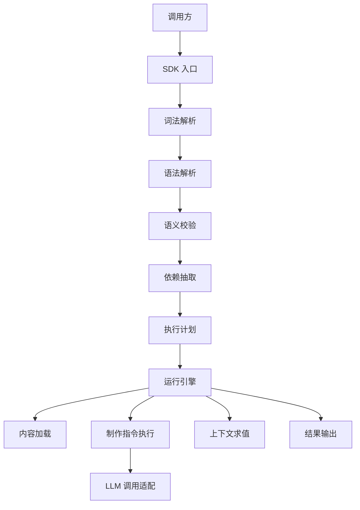
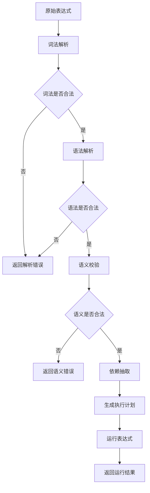

# SDK 设计

## 概述

SDK 是 prompts-glue 的提示词表达式处理核心，用于将提示词表达式解析为结构化表达，完成语义校验、依赖抽取、执行计划生成、提示词运行和结果追踪。

SDK 只关注提示词表达式与提示词内容本身，不负责远程包管理、网络访问、持久化、权限控制、CLI 交互、Web 页面流程或目标环境安装。外部系统可使用 SDK 的解析与运行能力，但表达式之外的业务流程应由调用方或对应模块负责。

## 设计目标

- 提供稳定的提示词表达式解析、校验和运行能力。
- 保持表达式语义与具体编程语言、模型供应商和运行环境无关。
- 支持提示词引用、版本规则、文本字面量、制作指令、组合运算符和上下文变量。
- 输出可追踪的依赖、执行计划、运行结果、缓存信息、token 用量和错误位置。
- 为 CLI、后端服务、Web、Manager 复用同一套表达式核心能力提供边界。
- 避免在多个模块中重复实现表达式解析、依赖抽取和提示词运行逻辑。

## 非目标

| 非目标 | 说明 |
|---|---|
| 远程包管理 | SDK 不搜索、下载、发布或管理远程提示词包 |
| 认证与权限 | SDK 不处理登录、令牌、用户身份和资源权限 |
| 持久化管理 | SDK 不管理数据库、远程存储或本地仓库生命周期 |
| CLI 交互 | SDK 不处理命令解析、终端展示、交互确认和配置写入 |
| Web 页面流程 | SDK 不处理页面状态、表单交互、审核流和运营操作 |
| 目标环境安装 | SDK 不生成目标环境安装计划，也不写入目标环境文件 |
| 包分发 | SDK 不负责提示词包的安装、升级、卸载和分发 |

## 适用场景

| 场景 | 说明 |
|---|---|
| 表达式语法检查 | 调用方提交 expression，SDK 返回结构化表达、错误位置和修正建议 |
| 依赖抽取 | 从表达式中提取提示词引用、版本规则和依赖关系 |
| 复合提示词运行 | 调用方提供依赖内容和上下文，SDK 运行表达式并生成最终提示词 |
| 实时提示词生成 | 调用方提交临时表达式和输入内容，SDK 计算并返回结果 |
| 发布前校验 | 发布模块调用 SDK 校验表达式、依赖关系和运行结果是否可生成 |
| 测试与审计 | 自动化流程调用 SDK 比较表达式变更、依赖变更和运行结果 |

## 模块边界

| 模块 | SDK 职责 | 非 SDK 职责 |
|---|---|---|
| 提示词制作规则 | 实现表达式解析、语义校验、执行计划和运行语义 | 定义业务概念和提示词包规范 |
| CLI | 复用 SDK 执行表达式相关能力 | 命令解析、配置合并、远程访问、文件写入和终端展示 |
| 后端服务 | 复用 SDK 校验和运行表达式 | API 认证、权限、存储、发布、缓存治理和审计 |
| Web 与 Manager | 复用 SDK 能力或调用后端结果 | 页面交互、审核流程、运营管理和用户体验 |
| LLM 服务 | 可被制作指令执行器调用 | 模型供应商适配、密钥管理和计费策略 |

SDK 可以通过调用方提供的内容加载器读取提示词引用内容，但内容来源由调用方决定。SDK 不知道内容来自文件、数据库、远程服务还是内存对象。

## 总体架构

## 核心组件

| 组件 | 职责 |
|---|---|
| SDK 入口 | 接收表达式、上下文、运行选项和调用方提供的内容加载能力 |
| 词法解析器 | 将原始表达式转换为 token 序列，保留位置和原文片段 |
| 语法解析器 | 将 token 序列转换为结构化表达，识别引用、指令、字面量和运算符 |
| 语义校验器 | 校验指令名称、参数数量、版本规则、变量引用和组合关系 |
| 依赖抽取器 | 从结构化表达中提取直接依赖、版本规则和引用位置 |
| 执行计划器 | 将结构化表达转换为可运行的步骤和依赖顺序 |
| 运行引擎 | 按执行计划加载内容、求值上下文、执行指令并生成结果 |
| 内容加载器 | 由调用方提供，根据提示词引用返回对应内容和元数据 |
| 制作指令执行器 | 执行摘要、合并、清洗、模板等制作指令，可使用本地规则或 LLM |
| 缓存协调器 | 基于调用方提供的缓存能力读写表达式解析结果和运行结果 |
| 结果追踪器 | 记录依赖、执行步骤、缓存命中、token 用量、警告和错误 |

## 表达式处理流程

## 表达式解析

表达式解析只负责理解表达式结构，不加载提示词内容、不调用 LLM、不访问外部系统。

| 输入 | 输出 |
|---|---|
| 原始 expression、解析选项 | 结构化表达、token 列表、依赖引用、错误和警告 |

解析要求：

- 支持提示词引用、版本规则、作用域包名、文本字面量、制作指令调用、指令参数、组合运算符和括号。
- 每个结构节点应保留来源位置，便于错误提示和编辑器高亮。
- 解析器应区分词法错误、语法错误和语义错误。
- 存在歧义时应提示调用方使用括号明确优先级。
- 表达式不得被当作脚本执行，也不得具备访问文件、网络或系统环境的能力。

## 结构化表达

结构化表达是表达式解析后的中间结果，用于语义校验、依赖抽取、执行计划生成和运行。

| 节点 | 说明 |
|---|---|
| 提示词引用节点 | 表示包名、作用域和可选版本规则 |
| 文本字面量节点 | 表示表达式中直接提供的文本输入 |
| 指令调用节点 | 表示制作指令名称、输入参数和指令参数 |
| 组合运算节点 | 表示合并、汇总、标签等组合关系 |
| 上下文变量节点 | 表示运行时由调用方提供的输入变量 |
| 分组节点 | 表示括号显式指定的计算顺序 |

结构化表达应保持语言无关，不包含具体编程语言类型或实现细节。

## 语义校验

语义校验在结构正确的基础上检查表达式是否具备可运行语义。

| 校验项 | 说明 |
|---|---|
| 制作指令 | 指令名称必须来自 dicts.md 中的提示词制作指令定义 |
| 参数数量 | 指令参数数量应满足该指令的输入要求 |
| 版本规则 | 提示词引用中的版本规则应符合 dicts.md 中的版本选择规则 |
| 组合关系 | 运算符两侧必须是可参与组合的表达式结果 |
| 上下文变量 | 变量名称应符合命名规则，缺失值在运行阶段处理 |
| 嵌套深度 | 表达式嵌套深度应受限制，避免不可控的运行成本 |
| 依赖循环 | 在调用方提供依赖表达式时，应检测表达式引用链是否形成循环 |

语义校验不判断某个包是否存在，也不判断用户是否有权访问某个包；这些属于调用方内容加载和权限控制职责。

## 依赖抽取

依赖抽取用于从表达式中提取提示词引用，不负责远程解析、下载或安装。

| 输出字段 | 说明 |
|---|---|
| name | 依赖包名 |
| version_rule | 表达式中声明的版本规则 |
| alias | 表达式中的可选别名或引用名称 |
| position | 引用在表达式中的位置 |
| required | 是否为运行必须依赖 |

依赖抽取结果可供调用方继续完成版本解析、权限检查、内容加载和发布校验。

## 执行计划

执行计划描述表达式的运行顺序和数据依赖关系。

| 内容 | 说明 |
|---|---|
| 步骤列表 | 表达式节点对应的运行步骤 |
| 输入依赖 | 每个步骤需要的上游结果或上下文变量 |
| 内容依赖 | 每个提示词引用需要调用方加载的内容 |
| 指令执行 | 每个制作指令的输入、参数和执行方式 |
| 缓存键素材 | 可用于生成缓存键的表达式、参数和依赖摘要 |

执行计划应可序列化和审计，便于测试表达式变更对运行结果的影响。

## 表达式运行

表达式运行在调用方提供内容和上下文后执行。

| 输入 | 说明 |
|---|---|
| 结构化表达或原始表达式 | 可直接运行已解析表达式，也可先解析再运行 |
| 内容加载器 | 根据依赖引用返回提示词内容、版本和元数据 |
| 上下文 | 变量、参数和调用方输入 |
| 运行选项 | 错误处理策略、缓存策略、输出形式、最大深度和 token 预算 |
| 指令执行器 | 执行制作指令所需的本地规则或 LLM 能力 |

运行要求：

- 运行引擎按执行计划顺序求值，不重新解释原始表达式。
- 提示词引用内容必须通过调用方提供的内容加载器获得。
- 制作指令执行方式取值见 [dicts.md](dicts.md) 中的“制作指令执行方式”定义。
- 错误处理策略取值见 [dicts.md](dicts.md) 中的“错误处理策略”定义。
- 运行过程应记录依赖内容摘要、执行步骤、缓存命中、token 用量和警告。

## 制作指令执行

制作指令由 SDK 内置的 LLM 执行器统一通过大语言模型实现；调用方只需提供 LLM 连接配置。

| 执行方式 | 说明 |
|---|---|
| LLM 调用 | 所有制作指令（含 `merge`/`synthesis`/`tags` 等组合运算符对应指令）均调用模型生成结果 |

执行要求：

- SDK 提供 `NewLLMExecutor(LLMConfig)` 构建内置执行器，对接 OpenAI 兼容的 `/chat/completions`。
- 每个指令的系统提示词由 SDK 内置默认值（取自 [prompts.md](prompts.md)「指令系统提示词」），调用方可通过 `LLMConfig.SystemPrompts` 按指令名覆盖。
- 指令 `{}` 参数作为「用户特别提示词」随输入内容一起发送给模型。
- 模型返回的真实 token 用量记入运行结果。
- **无本地回退**：调用方未提供执行器时，执行到任意指令或组合运算符即返回 `SDK_INSTRUCTION_FAILED`；纯文本、提示词引用和上下文变量不受影响。
- 模型名称、访问入口、密钥、代理、超时由调用方通过 `LLMConfig` 提供；重试、流式和 token 预算为后续增强。

## 缓存设计

SDK 缓存策略取值见 [dicts.md](dicts.md) 中的“提示词缓存策略”定义。

| 缓存对象 | 说明 |
|---|---|
| 解析缓存 | 缓存原始表达式到结构化表达的结果 |
| 语义校验缓存 | 缓存结构化表达的校验结果 |
| 执行计划缓存 | 缓存结构化表达到执行计划的转换结果 |
| 运行结果缓存 | 缓存相同表达式、依赖摘要、上下文摘要和指令配置下的结果 |

SDK 可以生成缓存键素材和缓存读写请求，但缓存存储位置、过期策略、容量限制和共享范围由调用方决定。

缓存内容不得包含密钥、令牌、认证凭据或调用方标记为敏感的输入。包含不可缓存标记的请求不应写入运行结果缓存。

## 数据对象

### SDK 配置

| 字段 | 类型 | 必填 | 说明 |
|---|---|---|---|
| parser | 解析配置 | 否 | 表达式长度、嵌套深度和语法兼容选项 |
| runtime | 运行配置 | 否 | 最大依赖深度、错误处理策略、输出形式和 token 预算 |
| cache | 缓存配置 | 否 | 是否启用缓存、缓存策略和敏感内容策略 |
| instructions | 指令配置 | 否 | 制作指令版本、执行方式和系统提示词配置；系统提示词默认值由 SDK 内置，可在此覆盖 |

SDK 配置只描述表达式解析和运行行为，不包含远程服务地址、认证信息、仓库路径或目标环境配置。

### 解析请求

| 字段 | 类型 | 必填 | 说明 |
|---|---|---|---|
| expression | 字符串 | 是 | 原始提示词表达式 |
| options | 解析选项 | 否 | 表达式长度、兼容模式和错误展示选项 |

### 解析结果

| 字段 | 类型 | 必填 | 说明 |
|---|---|---|---|
| ast | 结构化表达 | 条件必填 | 解析成功后的表达式结构 |
| tokens | token 列表 | 否 | 词法解析结果 |
| dependencies | 依赖引用列表 | 是 | 从表达式中抽取出的提示词引用 |
| errors | 错误列表 | 否 | 词法、语法或语义错误 |
| warnings | 字符串列表 | 否 | 非阻断性问题 |

### 运行请求

| 字段 | 类型 | 必填 | 说明 |
|---|---|---|---|
| expression | 字符串 | 条件必填 | 原始提示词表达式 |
| ast | 结构化表达 | 条件必填 | 已解析的表达式结构 |
| context | 映射 | 否 | 调用方输入变量和参数 |
| content_loader | 内容加载能力 | 是 | 根据依赖引用提供提示词内容 |
| instruction_executor | 指令执行能力 | 否 | 执行制作指令的 LLM 能力，通常由 `NewLLMExecutor` 构建；未提供时命中指令或运算符即返回 `SDK_INSTRUCTION_FAILED` |
| cache_strategy | 提示词缓存策略 | 否 | 本次运行使用的缓存策略 |
| error_strategy | 错误处理策略 | 否 | 运行失败时的处理策略 |
| output | SDK 输出形式 | 否 | 输出文本、消息序列或执行追踪，取值见 dicts.md |

`expression` 和 `ast` 至少提供一个。调用方提供 `ast` 时，SDK 可跳过解析阶段直接生成执行计划和运行。

### 运行结果

| 字段 | 类型 | 必填 | 说明 |
|---|---|---|---|
| content | 字符串 | 条件必填 | 文本形式的最终提示词 |
| messages | 消息列表 | 否 | 面向对话模型的结构化消息 |
| dependencies | 依赖列表 | 是 | 实际参与运行的依赖引用和内容摘要 |
| trace | 执行追踪 | 否 | 执行步骤、输入输出摘要和耗时 |
| calculation | 计算记录 | 是 | 缓存、token 和计算时间信息 |
| warnings | 字符串列表 | 否 | 非阻断性问题 |

## 与其他模块的关系

### 与提示词制作规则

SDK 实现 [prompts.md](prompts.md) 中表达式规则、制作指令语义、依赖抽取和错误处理策略。提示词制作规则定义业务语义，SDK 提供可复用的解析和运行能力。

### 与 CLI

CLI 可调用 SDK 完成表达式校验、依赖抽取、复合提示词运行和实时生成。CLI 自身负责命令解析、配置读取、文件操作、远程访问和用户确认。

### 与后端服务

后端服务可调用 SDK 完成发布前校验、实时生成和服务端渲染。后端服务自身负责认证、权限、存储、API 响应、审计和缓存治理。

### 与 Web 和 Manager

Web 与 Manager 可通过后端服务间接使用 SDK，也可在受控场景中使用 SDK 的解析能力进行前端预校验。页面流程、审核状态和运营管理不属于 SDK 职责。

## 错误处理

SDK 错误码取值见 [dicts.md](dicts.md) 中的“SDK 错误码”定义。

| 场景 | 处理要求 |
|---|---|
| 解析失败 | 返回错误位置、附近片段、错误类型和修正建议 |
| 语义校验失败 | 返回失败节点、规则名称和原因 |
| 依赖加载失败 | 返回依赖引用、版本规则和调用方加载器返回的错误摘要 |
| 依赖循环 | 返回循环路径并终止运行 |
| 上下文缺失 | 根据错误处理策略终止或使用默认值继续 |
| 指令执行失败 | 返回指令名称、输入摘要、失败阶段和可重试性 |
| 运行预算超限 | 终止运行并返回已完成步骤和预算消耗 |

错误信息应便于定位表达式问题，但不得暴露密钥、令牌、内部调用栈或敏感输入内容。

## 安全要求

- SDK 不得把表达式作为脚本执行。
- SDK 不得访问数据库或文件系统。
- SDK 通过内置 LLM 执行器访问模型服务时，仅使用调用方提供的 `LLMConfig`；不持久化认证凭据、密钥或令牌。
- SDK 不得自动加载与表达式依赖无关的上下文。
- 内容加载与缓存写入必须由调用方显式提供能力。
- 运行请求应支持表达式长度、嵌套深度、依赖数量和 token 预算限制。
- 错误、追踪和缓存摘要不得泄露敏感输入；LLM 执行器错误信息不回显完整 URL 或密钥。

## 质量要求

- 表达式解析、语义校验和运行结果应可测试、可审计、可复现。
- 结构化表达和执行计划应保持稳定，便于跨模块复用。
- SDK 错误对象应适合 CLI、Web、后端服务和自动化测试展示。
- 制作指令扩展应通过统一配置进入 SDK，不应分散在调用方重复实现。
- SDK 升级应保持核心表达式语义兼容；破坏性变化应通过版本策略明确发布。
